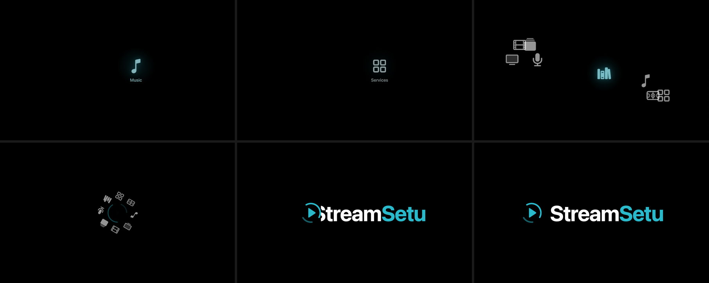
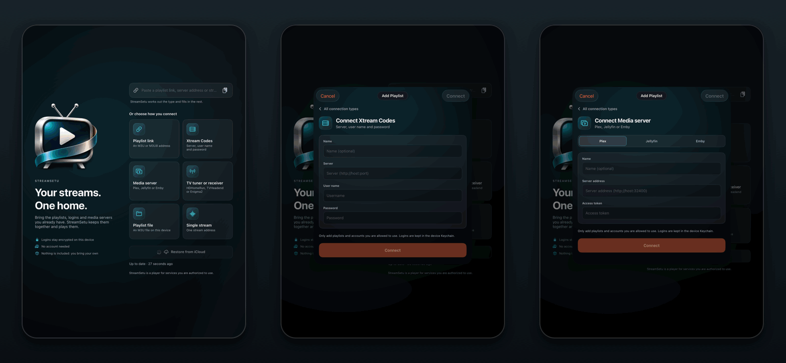

<h1>StreamSetu</h1>

<h3>Your streams. One home.</h3>

A native player for the IPTV playlists and media servers you already have, on Mac, iPhone, iPad, Android, Fire TV, Android TV and Windows.

**[⬇️ Download](#-download)** &nbsp;·&nbsp; **[✨ Features](#-features)** &nbsp;·&nbsp; **[🖼️ Screenshots](#%EF%B8%8F-screenshots)** &nbsp;·&nbsp; **[🔒 Privacy](#-privacy)** &nbsp;·&nbsp; **[💬 Support](#-support)** &nbsp;·&nbsp; **[⚖️ Legal](#%EF%B8%8F-disclaimer-and-legal-notice)**

> [!NOTE]
> StreamSetu is a player only. It provides **no channels, movies, series or subscriptions** and does not ship or link to any content. You bring your own legally obtained playlist or login. It is an independent project and is not affiliated with, funded, authorized or endorsed by any service it can connect to (see the [Disclaimer and legal notice](#%EF%B8%8F-disclaimer-and-legal-notice)).

> [!WARNING]
> **Music** and some other features reach third-party services through their public or unofficial interfaces, for example YouTube Music, JioSaavn, Deezer and SoundCloud. Using those services this way may be against their terms of service, they can change or stop working without notice, and some are not available in every country. You use them at your own risk and are responsible for following their terms and the laws that apply to you.
>
> StreamSetu is made for **personal, educational and research purposes only**, to show how a native media player can be built. It is not meant for commercial use, for redistributing content, or for anything that infringes copyright.

## 🖼️ Screenshots

### 🖥️ Mac

 <a href="docs/SCREENSHOTS.md#mac">All Mac screenshots →</a>

 The Mac opening on pure black, in your accent colour (frames from the app's own renderer).

### 📺 Fire TV and Android TV

 <a href="docs/SCREENSHOTS.md#fire-tv-and-android-tv">All Fire TV and Android TV screenshots →</a>

### 📱 iPhone

 <a href="docs/SCREENSHOTS.md#iphone">All iPhone screenshots →</a>

### 🤖 Android phone and tablet

 <a href="docs/SCREENSHOTS.md#android-phone">All Android phone screenshots →</a>

### 📱 iPad

 <a href="docs/SCREENSHOTS.md#ipad">All iPad screenshots →</a>

All pictures for every app: [docs/SCREENSHOTS.md](docs/SCREENSHOTS.md).

## ⬇️ Download

| Platform | What to get | Notes |
|---|---|---|
| **iPhone and iPad** | [Download on the App Store](https://apps.apple.com/us/app/stream-setu/id6821526110), or [join the TestFlight](https://testflight.apple.com/join/wYZ3vysQ), version 1.4 (build 79) | The App Store has the released version. TestFlight gets new builds first and is open to the first 100 testers; after that, ask for an invitation at contact@lokeshreddy.dev. |
| **Mac** | [`StreamSetu-2.19.1-AppleSilicon.dmg`](../../releases/download/2026.11.27/StreamSetu-2.19.1-AppleSilicon.dmg) (M-series Macs), [`StreamSetu-2.19.1-Intel.dmg`](../../releases/download/2026.11.27/StreamSetu-2.19.1-Intel.dmg) (Intel Macs); one release holds every app | Signed and notarized by Apple. Updates itself, with the file for your Mac. Not sure which? Apple menu → About This Mac: a **Chip** named Apple M1 or later is Apple silicon; a **Processor** made by Intel is Intel. |
| **Fire TV and Android TV** | [`streamsetu-tv-0.28.0.apk`](../../releases/download/2026.11.27/streamsetu-tv-0.28.0.apk) | Signed with the StreamSetu release key (new in 0.26.0: uninstall an older copy first). Remote layout. Android 5.1 or later. |
| **Android phone and tablet** | [`StreamSetu-Android-0.28.0.apk`](../../releases/download/2026.11.27/StreamSetu-Android-0.28.0.apk) | Signed with the same key. Touch layout. Android 5.1 or later. |
| **Windows** | [`StreamSetu-Windows-0.2.0.zip`](../../releases/download/2026.11.27/StreamSetu-Windows-0.2.0.zip) | A zip: unzip and run `StreamSetu.exe`. Windows 10 (version 1809) or later, 64-bit; [`StreamSetu-Windows-0.2.0-arm64.zip`](../../releases/download/2026.11.27/StreamSetu-Windows-0.2.0-arm64.zip) for Windows on ARM. Not signed, so SmartScreen may warn. |

Every download is on the [Releases](../../releases) page with its SHA-256 checksum (`shasum -a 256 <file>`). Needs macOS 14, iOS 18, Windows 10 or Android 5.1 (the mpv player needs Android 8). How a release is made: [docs/RELEASING.md](docs/RELEASING.md).

**Fire TV:** in **Settings → My Fire TV → Developer options** turn on **Install unknown apps** for Downloader, open Downloader and enter the code **7315299** (or open **aftv.news/7315299** in a browser), install, then open StreamSetu from **Your Apps & Channels**. If you have a build older than 0.26.0 installed, uninstall it first; the signing key changed.

**Android phone or tablet:** download the APK on the phone, open it, allow installs from your browser or files app when asked, then open StreamSetu.

## ✨ Features

The full table, app by app, is in [docs/FEATURES.md](docs/FEATURES.md). Where a feature is on some apps only, it says which.

### 🔌 Connections

| | |
|---|---|
| 🔑 **Xtream Codes, M3U and files** | Sign in with Xtream Codes, use an M3U link, or open an M3U file from the device. |
| 🗄️ **Media servers** | Jellyfin, Emby and Plex, next to your playlists. |
| 📡 **Tuners and receivers** | HDHomeRun, TVHeadend and Enigma2. |
| 📁 **Files and shares** | WebDAV servers and local video files. |
| 🌐 **Stalker and Ministra portals** | On Mac, Android phone and tablet, Fire TV and Android TV. |
| 🧰 **Per-connection settings** | A custom User-Agent, extra request headers and a proxy for each connection. |
| 🛡️ **App DNS** | Encrypted DNS for StreamSetu only, from a public provider or your own. It is not a VPN. |
| 🗃️ **All playlists together** | Keep several connections and browse them as one combined library. |

### 📺 Watch

| | |
|---|---|
| 📡 **Live TV** | Groups, channel numbers, favourites, and a channel that stops working tries the same channel in your other playlists. |
| 🗓️ **TV Guide and catch-up** | An XMLTV guide, past programmes through catch-up, and a live programme that began a while ago can start from its beginning. |
| 📻 **Radio mode** | Listen to radio channels as audio. |
| 🎬 **Movies and series** | Resume where you stopped, Up Next, and the best version first: 4K, then 1080p, never a cinema recording first, with the next best tried if one does not play. |
| 🪟 **Multi-View** | Watch several channels at once. It warns before opening more streams than your provider allows. |
| 🖼️ **Picture in Picture and casting** | Picture in Picture on every app except Fire TV and Android TV. AirPlay on Mac, iPhone and iPad, and casting on Android phones. |
| 🎧 **Sound in the background** | Sound keeps playing with lock-screen controls and a mini player on iPhone, iPad and Android phone, and with a small now-playing box while you browse. |
| ⏭️ **Skip intro, recap and credits** | One tap to skip, plus a sleep timer and go to an exact time. |
| 🔎 **Search from the player** | Search the whole catalog without leaving the video, with All, Movies, Series and Live TV. |
| 💬 **Subtitles and sound** | Subtitles from a file or from the subtitle service with your own free key, fetched on their own when a title has none in your language. Size, colour, position and background, and subtitle and sound timing. |
| 🎚️ **Picture and volume** | Brightness, contrast, saturation and gamma, a volume boost above 100%, and a choice of resolution when a stream offers several. |
| 🧠 **Remembered settings** | Audio, subtitles, speed and timing are remembered for each title or channel. |
| 📊 **Stats overlay** | Decoder, bitrate, buffer and dropped frames, and a picture of the current frame saved on request. |
| 👆 **Gestures** | Swipe to change channel on iPhone and iPad, and double-tap skip, brightness and volume on iPhone, iPad and Android phone. |
| 🔁 **Another app** | Play a stream in another player app, or share a channel, movie or series as a link. |
| 🎞️ **Player engines** | Apple's AVPlayer or Android's ExoPlayer for common formats, and mpv for MKV, AVI, RTSP and unusual codecs. Choose a different engine for Live TV, movies, series and past programmes. |

### 🗂️ Your library

| | |
|---|---|
| ⭐ **Favourites and history** | Favourites in your own order, Watch Later, Recently Watched and Continue Watching, with a green tick on watched titles and a bar on started ones. |
| 🗂️ **Collections and folders** | Collections of your own. Folders you can reorder, hide, rename and lock with a PIN. A Folders view shows one row per folder. |
| 🔍 **Search that works offline** | Search by title, actor or director, or by a sentence such as "telugu movies 2024 unwatched". |
| 🧩 **Filters and smart lists** | Filter by language, quality, rating, decade and watch status. Smart lists show Unwatched, Unwatched favourites and Added in 30 days (Mac, iPhone and iPad); smart collections of your own on Fire TV and Android TV. |
| 🆕 **New episodes** | A badge on series you watch, and the next episode of your series on Tonight. |
| 📥 **Queue** | Play Next and Add to Queue. |
| 🏷️ **Quality and sound badges** | 4K, HDR, Dolby Vision, Atmos and 5.1 on movie and series pages. |
| 📚 **Title pages** | Reworked pages for movies and series, with a cast row and photos, a person screen with their titles in your library, other languages and versions, an "In folder" link, and the same stars on a title everywhere. |
| 🎯 **Suggestions** | A For You row, Smart Mix Home rows (Top This Week, Trending in Your Library, Because You Watched, Rediscover), genre shelves, a timeline of a film's whole franchise, and More like this, each with its reason. Don't Recommend This keeps a title out. |
| 🖼️ **Artwork and details** | Better matching of titles to artwork and details from the details service, which works out of the box and can be turned off. Designed tiles for titles with no poster. |
| 🌙 **Tonight** | What is on now and next on your favourite channels, what is set to record, and the next episode of your series. |
| 🔔 **Guide alerts and reminders** | Add a word such as a sport, a team or a show and get a reminder when a programme with it is coming up, and set reminders for programmes. |
| ⏺️ **Recording** | Record a live channel and schedule a recording from the TV Guide on Mac, Android and TV. Record a programme every week on Mac while the app is open. |
| ⬇️ **Downloads** | Watch without a connection, with a progress ring, and an Offline Home that shows the downloads that still play. They can delete themselves after you watch them. |
| 🎙️ **Podcasts** | Search, follow and play, with your place kept. On the Mac the charts follow the country you pick and a row shows your categories. |
| 🎵 **Music (Mac)** | Listen Now from your own listening, Explore, Recently Added, Library, artist, album and film pages, lyrics, crossfade and Automix, your own sources, and Listen Together. |
| 🧭 **Get set up (Mac)** | A short, full-window, three-step setup in your theme: skip adding a playlist and use Music, Podcasts and the streaming services at once. Choose whether Music's own setup runs when you finish, your podcast country and the categories you like, and which services are pinned to the top bar (with their own icons). Open it again any time from Help, Get Set Up. |
| 📈 **Your week and your usual time** | Time watched and the most watched title each week, an optional Sunday evening notification, and a one-tap play for what you often put on around the same hour. |
| 📋 **Channel tools** | Hide, rename and check channels, a Channel Manager and a health check. Watch statistics, and subscription end dates for playlists that report them. |
| 🙈 **Watch Privately** | Play one title, series or channel without leaving history, resume points, statistics or anything to sync. |
| 🔐 **Locked and hidden folders** | Left out of counts, search, recommendations, widgets, Watch Next, cast and similar titles, and never sent to the details service. |
| 📱 **Widgets and SharePlay** | A Continue Watching widget and a download Live Activity on iPhone, and SharePlay to watch a film or a live channel together over FaceTime on iPhone and iPad. |

### 👪 Profiles and control

| | |
|---|---|
| 👤 **Profiles** | Up to four people on one device, each with their own favourites, collections, history and resume points, and PINs. |
| 🧒 **Kids profile** | Keeps locked folders hidden, with viewing limits: minutes a day and night hours, and the profile's PIN adds time. |
| 🛂 **Parental controls** | Restrict what each profile can see. |
| 🧾 **Privacy report** | What is kept on the device and what can leave it, with each item's current state. |
| 🎨 **Look and feel** | Themes and accent colours, screen reader labels, an opening (Automatic or Off, and a still picture with Reduce Motion; on the Mac it is pure black: the first time, your app's destination icons cross the screen one at a time with their names, each lighting in your accent colour at the centre, then come together and spin into the StreamSetu symbol, and the name slides out from behind it; on every launch after that, the symbol turns once, as in the top bar, and the name slides out), and Hindi and Telugu on the main screens. |

### 🤖 Assistant and search

| | |
|---|---|
| 🤖 **Setu assistant** | A chat bubble on Mac, iPhone and iPad that finds something to watch, answers about your screen, settings and playback problems, and offers actions you tap to confirm. It is hidden in kids mode. |
| 🔌 **Bring your own AI** | Use Apple Intelligence where it is available, a hosted service with your own key, or a server on your network. Each shows its price and free limit. |
| ✨ **Ask from the search box** | Ask AI when a request finds nothing, and use commands: go to a screen, play, resume, last channel, add or remove a favourite or Watch Later. |
| 🗣️ **Sort and filter words** | "Top rated telugu movies", "newest series", "comedy not horror", and moods such as "date night" or "something short". |
| 🕘 **Watch-history and linked accounts** | Tell the watch-history service what you watch and copy your watchlist into Watch Later, and play linked-account links with your own token. |

### ☁️ Sync and updates

| | |
|---|---|
| ☁️ **iCloud sync** | Between your Apple devices. |
| 📶 **Sync on this network** | Over Wi-Fi with no account, and see what is playing on your other devices with Play here. |
| 💾 **Backup and restore** | Including automatic weekly backups. |
| 🔄 **Refresh** | Playlists refresh when the app opens, and while the app is closed on iPhone, iPad, Android and TV. |
| 🗣️ **Siri, Shortcuts and Spotlight** | Siri and Shortcuts on iPhone and iPad, and Spotlight finds StreamSetu's screens and settings on Mac and iPhone. |
| 🔗 **Links** | `streamsetu://` links play a channel or a movie, search, open a tab, a screen or a setting, pause, resume and set the sleep timer (play and search on Android and TV). |
| 📺 **Android TV home** | A Continue Watching row on the Android TV home screen. |
| ⬆️ **Updates** | The Mac updates itself. iPhone and iPad update through the App Store or TestFlight. Android and TV check for a new version and ask before installing. |

### 🍏 Streaming services in the Mac app

A Services menu opens eleven streaming services' own sites inside StreamSetu, each with its own icon in a themed panel.

- Pin the ones you use to the top bar and move them left or right.
- Switching service stops the sound of the one you left.
- Each service keeps its own sign-in and data, separate from the others. **Clear Data** in Settings, or the right-click menu on a pinned service, clears just that one.
- If a service does not load, a message says why.
- An optional page setting for one service (off by default, asked first) can skip its video ads and community-marked sponsor segments.
- You sign in with your own account. StreamSetu does not sell or include any service.

## 🔒 Privacy

- No ads, no analytics and no account.
- Your playlists, logins and history stay on your device.
- iCloud and Wi-Fi sync are optional.
- A diagnostic report (Settings → Diagnostics) contains no logins or provider addresses and is safe to attach to a message.

Read the [Privacy policy](legal/privacy.md) and the [Terms](legal/terms.md).

## 📚 Read more

| Guide | What's inside |
|---|---|
| [What each app does](docs/FEATURES.md) | The feature table, app by app |
| [Getting around](docs/GETTING-AROUND.md) | The remote, touch and keyboard controls |
| [Fire TV and Android in detail](docs/FIRETV-ANDROID.md) | Sources, playback, search and privacy on TV |
| [Known limits](docs/KNOWN-LIMITS.md) | What an app does not do yet |
| [Building](docs/BUILDING.md) | Folders, build commands and compatibility |
| [Releasing](docs/RELEASING.md) · [Release security](docs/RELEASE-SECURITY.md) | How downloads are made and checked |
| [Privacy policy](legal/privacy.md) · [Terms](legal/terms.md) | Legal |

## 💬 Support

Write to contact@lokeshreddy.dev. A diagnostic report (Settings → Diagnostics) contains no logins or provider addresses and is safe to attach.

## ⚖️ Disclaimer and legal notice

StreamSetu is an independent, personal project. It is **not** associated with, sponsored by, authorized by or endorsed by Apple, Google, YouTube, Amazon, Microsoft, Deezer, JioSaavn, SoundCloud, Audius, Spotify, TMDB, Plex, Jellyfin, Emby or any other company or service named in the app or in this repository, or by any of their parent companies, affiliates or subsidiaries.

- **No content, no hosting.** StreamSetu does not host, upload, store, sell, rent, rebroadcast or recommend copyrighted media. It is an interface: it plays the playlists, media servers and accounts that **you** add, and it streams from the public, public-facing or user-authenticated interfaces of the services you choose. No playlist, channel list, key or credential comes with it.
- **You are responsible.** Only add playlists, accounts and streams that you are legally entitled to access. You alone are responsible for what you play and for following the copyright laws of your country and the terms of service of every provider you use, including YouTube's Terms of Service. Do not use StreamSetu to infringe copyright or to get around any protection on content.
- **Educational purposes only.** StreamSetu is made for personal, educational and research purposes: to learn from and to show how a native media player is built. It is for non-commercial use on devices you own or control, and it is not meant to be used, sold or offered as a service for redistributing content or for anything that infringes copyright.
- **Third-party services can change.** Services reached through public or unofficial interfaces may change, restrict or block access at any time, and some are limited by country. StreamSetu cannot promise that any of them will keep working, and it does not help anyone avoid a regional restriction.
- **No guarantee about ads or access.** StreamSetu does not promise to remove advertising, to bypass a paywall, or to give access to anything a provider does not already give you.
- **Trademarks.** All names, logos, trademarks, service marks and other intellectual property mentioned here or in the apps belong to their respective owners and are used only to say what StreamSetu works with. This product uses the TMDB API but is not endorsed or certified by TMDB.
- **No warranty.** StreamSetu is provided as it is, without warranty of any kind. Streams depend on your provider and your network, and playback is not guaranteed. To the extent the law allows, the author is not liable for any loss or damage from using it.

The full wording is in the [Terms of Use](legal/terms.md) and the [Privacy policy](legal/privacy.md); software from other authors is listed, with its licences, in [Open-source licences](legal/licenses.md).

## 📜 Licence

The source is published so it can be read. Unless a licence file says otherwise, all rights in StreamSetu's own code and artwork are reserved by the author. StreamSetu uses third-party software under its own licences, including AndroidX Media3 (Apache 2.0), mpv/libmpv (LGPL 2.1 or later, GPL in some builds), OkHttp, Retrofit, Coil, Hilt, Room, ZXing and Sparkle.
