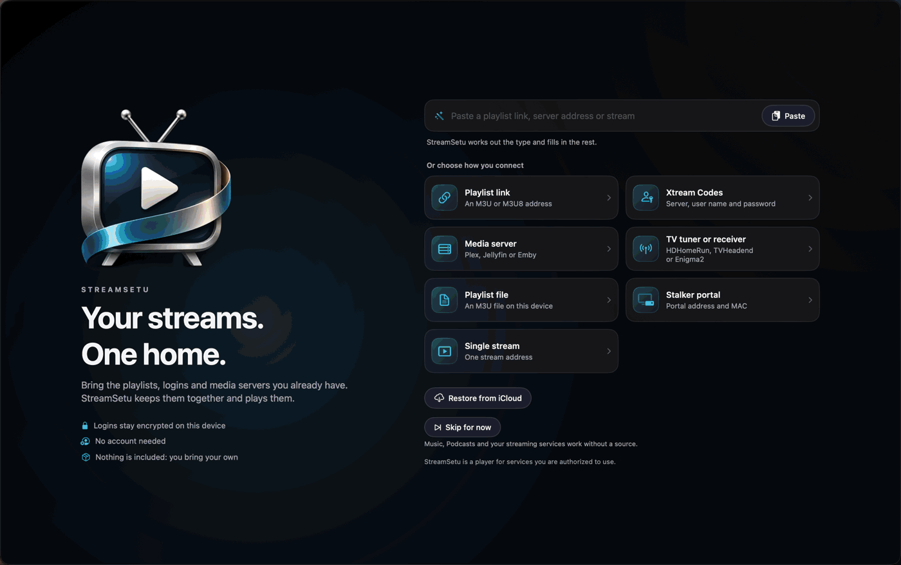
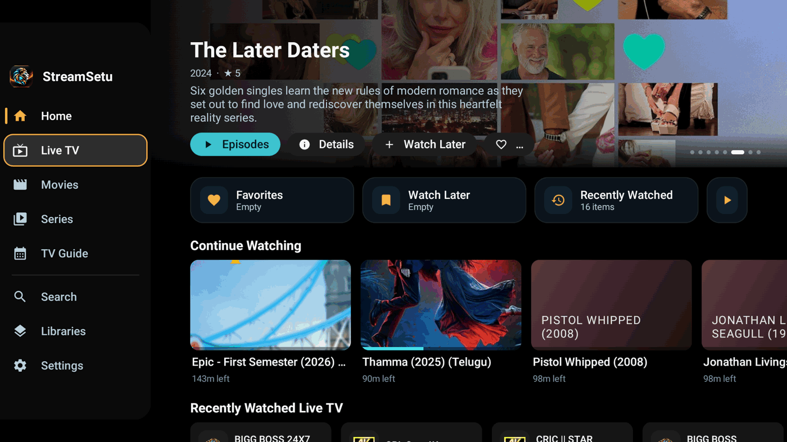
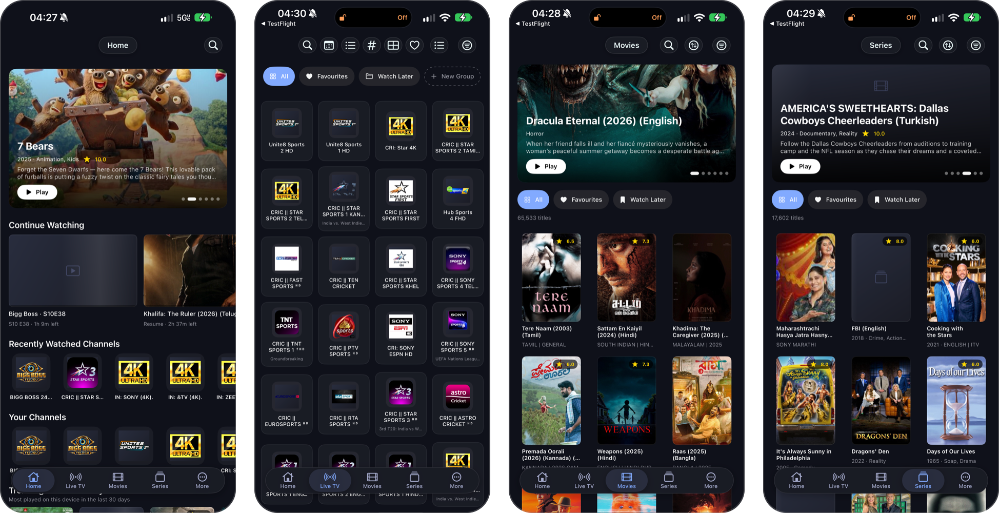
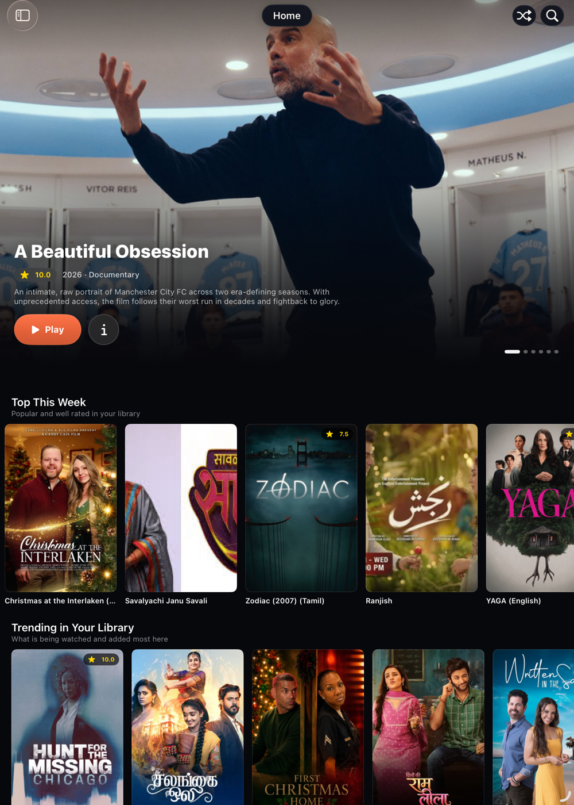
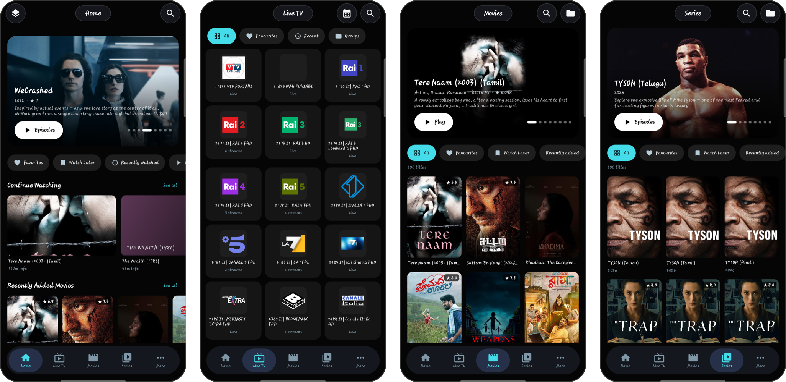

<h1>StreamSetu</h1>

<h3>Your streams. One home.</h3>

A native player for the IPTV playlists and media servers you already have, on Mac, iPhone, iPad, Android, Fire TV, Android TV and Windows.

**[⬇️ Download](#-download)** &nbsp;·&nbsp; **[✨ Features](#-features)** &nbsp;·&nbsp; **[🖼️ Screenshots](#%EF%B8%8F-screenshots)** &nbsp;·&nbsp; **[🔒 Privacy](#-privacy)** &nbsp;·&nbsp; **[💬 Support](#-support)**

> [!NOTE]
> StreamSetu is a player only. It provides **no channels, movies, series or subscriptions** and does not ship or link to any content. You bring your own legally obtained playlist or login.

## 🖼️ Screenshots

### 🖥️ Mac

 <a href="docs/SCREENSHOTS.md#mac">All Mac screenshots →</a>

### 📺 Fire TV and Android TV

 <a href="docs/SCREENSHOTS.md#fire-tv-and-android-tv">All Fire TV and Android TV screenshots →</a>

### 📱 iPhone

 <a href="docs/SCREENSHOTS.md#iphone">All iPhone screenshots →</a>

### 📱 iPad

 <a href="docs/SCREENSHOTS.md#ipad">All iPad screenshots →</a>

### 🤖 Android phone and tablet

 <a href="docs/SCREENSHOTS.md#android-phone">All Android phone screenshots →</a>

All pictures for every app: [docs/SCREENSHOTS.md](docs/SCREENSHOTS.md).

## ⬇️ Download

| Platform | What to get | Notes |
|---|---|---|
| **iPhone and iPad** | [Download on the App Store](https://apps.apple.com/us/app/stream-setu/id6821526110), or [join the TestFlight](https://testflight.apple.com/join/wYZ3vysQ), version 1.4 (build 79) | The App Store has the released version. TestFlight gets new builds first and is open to the first 100 testers; after that, ask for an invitation at contact@lokeshreddy.dev. |
| **Mac** | [`StreamSetu-2.18.0.dmg`](../../releases/download/2026.11.23/StreamSetu-2.18.0.dmg), one release holds every app | Signed and notarized by Apple. Updates itself. Apple silicon and Intel. |
| **Fire TV and Android TV** | [`streamsetu-tv-0.27.0.apk`](../../releases/download/2026.11.23/streamsetu-tv-0.27.0.apk) | Signed with the StreamSetu release key (new in 0.26.0: uninstall an older copy first). Remote layout. Android 5.1 or later. |
| **Android phone and tablet** | [`StreamSetu-Android-0.27.0.apk`](../../releases/download/2026.11.23/StreamSetu-Android-0.27.0.apk) | Signed with the same key. Touch layout. Android 5.1 or later. |
| **Windows** | [`StreamSetu-Windows-0.2.0.zip`](../../releases/download/2026.11.21/StreamSetu-Windows-0.2.0.zip) | A zip: unzip and run `StreamSetu.exe`. Windows 10 (version 1809) or later, 64-bit; [`StreamSetu-Windows-0.2.0-arm64.zip`](../../releases/download/2026.11.21/StreamSetu-Windows-0.2.0-arm64.zip) for Windows on ARM. Not signed, so SmartScreen may warn. |

Every download is on the [Releases](../../releases) page with its SHA-256 checksum (`shasum -a 256 <file>`). Needs macOS 14, iOS 18, Windows 10 or Android 5.1 (the mpv player needs Android 8). How a release is made: [docs/RELEASING.md](docs/RELEASING.md).

**Fire TV:** in **Settings → My Fire TV → Developer options** turn on **Install unknown apps** for Downloader, open Downloader and enter the code **7315299** (or open **aftv.news/7315299** in a browser), install, then open StreamSetu from **Your Apps & Channels**. If you have a build older than 0.26.0 installed, uninstall it first; the signing key changed.

**Android phone or tablet:** download the APK on the phone, open it, allow installs from your browser or files app when asked, then open StreamSetu.

## ✨ Features

The full table for every app is in [docs/FEATURES.md](docs/FEATURES.md).

### 🔌 Bring what you have

| | |
|---|---|
| 🔑 **Xtream logins** | Sign in once and your live TV, movies and series appear. |
| 📄 **M3U links and files** | Use a link, or a file from the device. |
| 🗄️ **Media servers** | Jellyfin, Emby and Plex, next to your playlists. |
| 📡 **Tuners and receivers** | HDHomeRun, TVHeadend and Enigma2. |
| 📁 **Files and shares** | WebDAV and local video files. |
| 🌐 **Stalker portals** | On Mac, Android and Fire TV. |

### 📺 Watch

| | |
|---|---|
| 📡 **Live TV** | Groups, channel numbers, favourites and your own folders. |
| 🗓️ **TV Guide and catch-up** | See what is on, and go back to what you missed. |
| 🎬 **Movies and series** | Resume where you stopped, jump to the next episode, best version first. |
| 🔍 **Fast search** | One search across channels, films, series and the guide. |
| 🪟 **Multi-View** | Watch several channels at once, on the apps that have it. |

### ⚙️ Players

| | |
|---|---|
| 🍎 **Native player** | Apple's AVPlayer on Apple devices, ExoPlayer on Android. Best for common formats. |
| 🎞️ **mpv** | For MKV, AVI, RTSP and unusual codecs. |

### 🔒 Your data

| | |
|---|---|
| 🙈 **Private by design** | No ads, no analytics, no account. |
| ☁️ **Optional sync** | iCloud or Wi-Fi sync, only if you turn it on. |
| 🛡️ **App DNS** | Optional encrypted DNS for StreamSetu only. It is not a VPN. |

### 🧩 Extras

| | |
|---|---|
| 🤖 **Setu assistant** | Optional help inside the app. |
| 🕘 **Watch history and artwork** | Optional watch-history service and details service artwork (built-in key, or your own). |
| ⏺️ **Recording and reminders** | Record, and get reminded before a programme starts. |

### 🍏 Streaming services in the Mac app

A Services menu opens ten streaming services' own sites inside StreamSetu, each with its own icon in a themed panel.

- Pin the ones you use to the top bar and move them left or right.
- Switching service stops the sound of the one you left.
- Each service keeps its own sign-in and data, separate from the others. **Clear Data** in Settings, or the right-click menu on a pinned service, clears just that one.
- If a service does not load, a message says why.
- An optional page setting for one service (off by default, asked first) can skip its video ads and community-marked sponsor segments.
- You sign in with your own account. StreamSetu does not sell or include any service.

## 🔒 Privacy

- No ads, no analytics and no account.
- Your playlists, logins and history stay on your device.
- iCloud and Wi-Fi sync are optional.
- A diagnostic report (Settings → Diagnostics) contains no logins or provider addresses and is safe to attach to a message.

Read the [Privacy policy](legal/privacy.md) and the [Terms](legal/terms.md).

## 📚 Read more

| | |
|---|---|
| [What each app does](docs/FEATURES.md) | The feature table, app by app |
| [Getting around](docs/GETTING-AROUND.md) | The remote, touch and keyboard controls |
| [Fire TV and Android in detail](docs/FIRETV-ANDROID.md) | Sources, playback, search and privacy on TV |
| [Known limits](docs/KNOWN-LIMITS.md) | What an app does not do yet |
| [Building](docs/BUILDING.md) | Folders, build commands and compatibility |
| [Releasing](docs/RELEASING.md) · [Release security](docs/RELEASE-SECURITY.md) | How downloads are made and checked |
| [Privacy policy](legal/privacy.md) · [Terms](legal/terms.md) | Legal |

## 💬 Support

Write to contact@lokeshreddy.dev. A diagnostic report (Settings → Diagnostics) contains no logins or provider addresses and is safe to attach.

## 📜 Licence

The source is published so it can be read. Unless a licence file says otherwise, all rights in StreamSetu's own code and artwork are reserved by the author. StreamSetu uses third-party software under its own licences, including AndroidX Media3 (Apache 2.0), mpv/libmpv (LGPL 2.1 or later, GPL in some builds), OkHttp, Retrofit, Coil, Hilt, Room, ZXing and Sparkle.
