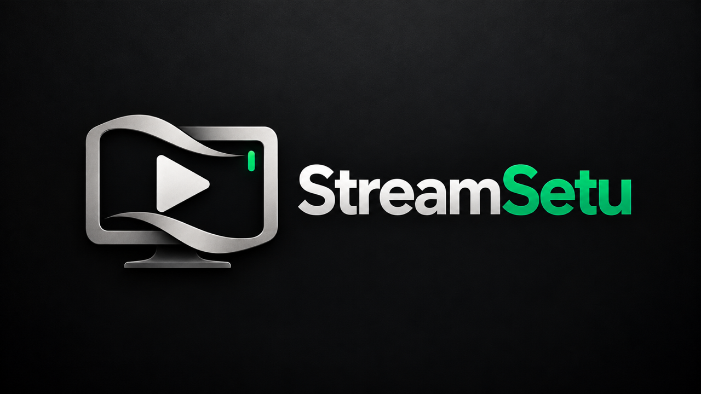

<p align="center">
  
</p>

# StreamSetu

**Your streams. One home.**

StreamSetu is a native player for the IPTV playlists and media servers you already have. It runs on **Mac, iPhone and iPad, Android phones and tablets, Fire TV and Android TV**, with **Windows coming soon**, keeps everything on your own device, and has no account, no advertising and no analytics.

> StreamSetu is a player only. It provides **no channels, movies, series or subscriptions**, and it does not ship or link to any content. You bring your own legally obtained playlist or login.

## Screenshots

### Mac

<table>
  <tr>
    <td width="50%" valign="top"></td>
    <td width="50%" valign="top"></td>
  </tr>
  <tr>
    <td align="center"><sub>Home</sub></td>
    <td align="center"><sub>Live TV</sub></td>
  </tr>
  <tr>
    <td width="50%" valign="top"></td>
    <td width="50%" valign="top"></td>
  </tr>
  <tr>
    <td align="center"><sub>Movies</sub></td>
    <td align="center"><sub>Series</sub></td>
  </tr>
</table>

### Fire TV and Android TV

<table>
  <tr>
    <td width="50%" valign="top"></td>
    <td width="50%" valign="top"></td>
  </tr>
  <tr>
    <td align="center"><sub>Home, sidebar open</sub></td>
    <td align="center"><sub>Live TV</sub></td>
  </tr>
  <tr>
    <td width="50%" valign="top"></td>
    <td width="50%" valign="top"></td>
  </tr>
  <tr>
    <td align="center"><sub>Movies</sub></td>
    <td align="center"><sub>Series</sub></td>
  </tr>
</table>

### Android phone

<table>
  <tr>
    <td width="25%" valign="top"></td>
    <td width="25%" valign="top"></td>
    <td width="25%" valign="top"></td>
    <td width="25%" valign="top"></td>
  </tr>
  <tr>
    <td align="center"><sub>Home</sub></td>
    <td align="center"><sub>Live TV</sub></td>
    <td align="center"><sub>Movies</sub></td>
    <td align="center"><sub>Series</sub></td>
  </tr>
</table>

### iPhone

<table>
  <tr>
    <td width="25%" valign="top"></td>
    <td width="25%" valign="top"></td>
    <td width="25%" valign="top"></td>
    <td width="25%" valign="top"></td>
  </tr>
  <tr>
    <td align="center"><sub>Home</sub></td>
    <td align="center"><sub>Live TV</sub></td>
    <td align="center"><sub>Movies</sub></td>
    <td align="center"><sub>Series</sub></td>
  </tr>
</table>

The artwork in these screenshots comes from the provider's own playlist. StreamSetu ships no content.

## Download

| Platform | What to get | Notes |
|---|---|---|
| **Mac** | [`StreamSetu-2.14.8.dmg`](../../releases/download/2026.10.22/StreamSetu-2.14.8.dmg), one release holds every app | Signed and notarized by Apple. Updates itself. Apple silicon and Intel. |
| **Fire TV and Android TV** | [`StreamSetu-FireTV-0.19.0.apk`](../../releases/download/2026.10.25/StreamSetu-FireTV-0.19.0.apk) | Signed with the StreamSetu release key. Remote layout. Android 5.1 or later. |
| **Android phone and tablet** | [`StreamSetu-Android-0.19.0.apk`](../../releases/download/2026.10.25/StreamSetu-Android-0.19.0.apk) | Signed with the same key. Touch layout. Android 5.1 or later. |
| **iPhone and iPad** | [Join the TestFlight](https://testflight.apple.com/join/wYZ3vysQ), version 1.1 | Open to the first 100 testers. After that, ask for an invitation at contact@lokeshreddy.dev. |
| **Windows** | Coming soon | Not released yet. |

The two Android files hold the same build, listed separately so each device has its own download. The app picks the remote or touch layout by itself. Every download has a SHA-256 checksum in its release notes. Verify it with `shasum -a 256 <file>`.

Every download is on this repository's [Releases](../../releases) page: one release per update, named by date, with the Mac, Android and Fire TV files and a section for each app. How releases are made is in [docs/RELEASING.md](docs/RELEASING.md).

If you have a Mac copy older than 2.3.1, it cannot update itself (the old update feed was removed when everything moved into this repository). Download 2.3.1 once from the table above; it updates itself from then on.

### Installing on Android phone or tablet

1. Download `StreamSetu-Android-0.19.0.apk` on the phone.
2. Open it and, when asked, allow installs from your browser or files app.
3. Open StreamSetu.

### Installing on Fire TV

1. On the Fire TV: **Settings → My Fire TV → Developer options**, then turn on **Install unknown apps** for the app you will use to download (for example Downloader).
2. Open that app, enter the APK's address from the Releases page, and install.
3. Open StreamSetu from **Your Apps & Channels**.

If you installed an earlier test build, uninstall it first: test builds before 0.5.0 were signed with a different key, and Android will not install an update signed with another key.

## Getting around

### Android phone and tablet

The Android app detects a phone or tablet and shows a touch layout, laid out like the iPhone app: a floating tab bar (Home, Live TV, Movies, Series, More), a banner you can tap, folder and list chips, poster and channel grids, and sheets that slide up for menus. Touch and hold a title for its menu. The player turns with the phone: tap the picture to show the controls, double-tap the left or right side to skip, drag the bar to seek, swipe up or down on the left for brightness and on the right for volume. A Fire TV or Android TV keeps the remote layout below.

### Fire TV and Android TV remote

| Press | What happens |
|---|---|
| **Back** on a page, or **Left** at the page's edge | Slides the sidebar in: Home, Live TV, Movies, Series, TV Guide, Search, Libraries, Settings. It hides itself again as soon as the cursor is back on the page (**Right** returns to the page). |
| **Up / Down** in the sidebar | Moves between sections. Nothing opens until you press OK. |
| **OK** on a section | Opens it, hides the sidebar and puts the cursor on that page's first button or row. |
| **Right** from Live TV's folders | Moves into the channels. **Left** goes back to the folders. On Movies and Series, folders are the *Folders* button and the Categories row under the banner. |
| **OK** on a poster or channel | Opens its detail page, or plays a channel. |
| **Hold OK**, about half a second | The menu for what's under the cursor: favorite, Watch Later, mark watched, pin, hide, move, lock, rename, and the like. |
| **Back** inside a page | One step up: close the menu, leave the detail page (the cursor returns to the poster you left), then the sidebar, then Home. From Home, Back returns to the library chooser; it never closes the app from inside a library. |
| **Menu** key | Opens the same menu as holding OK, on remotes that have the key. |

**Libraries.** The first screen lists your connections. Pick one and choose **Open Library**. **Manage Library** edits or removes it, and **Add another** or the Quick Add buttons set up Xtream Codes, M3U, a local file or a combined library. Choose **Libraries** in the sidebar to come back here.

**Folders.** Every folder is a provider category. Hold OK on a folder to reorder it, hide it, lock it with a PIN, favorite it, pin it to the top, or rename it. Your changes stay on this device and never change the provider's playlist. **New folder** makes a collection of your own. The shortcut chips above the posters (Favorites, Watch Later, Recently Watched, Continue Watching) show those lists for the current section.

**Search.** Choose **Search** in the sidebar, or the Search chip on a page. Type with the on-screen keyboard, or scan the QR code and type on your phone.

### While something is playing

| Press | Movies and episodes | Live TV |
|---|---|---|
| **OK** | Show the controls, or pause and resume | Show the controls |
| **Left / Right** | Skip back or forward, 10 seconds by default, changeable in Settings | Left opens the channel list |
| **Up / Down** | Down moves to the buttons along the bottom | Next or previous channel |
| **Number keys** | | Type a channel number and wait a moment |
| **Menu or Info** | Opens the More panel: start over, sleep timer, 15 to 120 minutes, jump, 10 seconds to 10 minutes, audio and subtitle sync, stream information, picture in picture, close player | The same, plus favorite and last channel |
| **Play/Pause, Fast-forward, Rewind, Next, Previous** | Work as on any media remote | Next and Previous change channel |
| **Back** | Hides the controls when they are showing. With them hidden, asks "Stop watching?" so a stray press doesn't end the film. Choose Continue watching or Exit the player. | Same |

The buttons along the bottom open the episode list, channel list, audio and subtitles, speed, picture shape and which player (ExoPlayer or mpv) is in use. Press **Up** to return to the picture. If a stream does not play, the screen offers **Try Again**, **Next Channel** and **Close**.

### Mac

The top bar switches between Home, Live TV, Movies, Series and TV Guide, and each section has its own list on the left. Keyboard shortcuts (the full list is under **Cmd+/**, Keyboard Shortcuts):

| Keys | Action |
|---|---|
| **Cmd+1 to 5** | Switch section |
| **Cmd+K** | Search everything |
| **Cmd+F** | Search within the current screen |
| **Cmd+N** | Add a playlist |
| **Cmd+O** | Open a video file |
| **Cmd+R** | Refresh all playlists |
| **Cmd+Shift+M** | Open Multi-View |

### iPhone and iPad

Use the tab bar at the bottom: Home, Live TV, Movies, Series and More. Tap a poster for its page, and use the buttons at the top for search, sorting and filters.

## What each app does

A tick means the app has it today. A dash means it does not have it yet. The table was checked against the code of each app, and a feature I could not confirm for every app is left out rather than guessed. On the Android phone the TV Guide is a list of channels with what is on now and next, not the full grid.

| | Mac | iPhone | iPad | Android phone / tablet | Fire TV / Android TV |
|---|:-:|:-:|:-:|:-:|:-:|
| **Connections** | | | | | |
| Xtream Codes login | ✓ | ✓ | ✓ | ✓ | ✓ |
| M3U link | ✓ | ✓ | ✓ | ✓ | ✓ |
| M3U file from the device | ✓ | ✓ | ✓ | ✓ | ✓ |
| Stalker / Ministra portal | ✓ | – | – | ✓ | ✓ |
| Jellyfin, Emby, Plex | ✓ | ✓ | ✓ | ✓ | ✓ |
| HDHomeRun, TVHeadend, Enigma2 | ✓ | ✓ | ✓ | ✓ | ✓ |
| WebDAV server and local video files | ✓ | ✓ | ✓ | ✓ | ✓ |
| Custom User-Agent per connection | ✓ | ✓ | ✓ | ✓ | ✓ |
| Extra request headers per connection, and a proxy | ✓ | ✓ | ✓ | ✓ | ✓ |
| **Watching** | | | | | |
| Live TV with groups and channel numbers | ✓ | ✓ | ✓ | ✓ | ✓ |
| TV Guide, XMLTV | ✓ | ✓ | ✓ | ✓ | ✓ |
| Catch-up for past programmes | ✓ | ✓ | ✓ | ✓ | ✓ |
| Radio mode | ✓ | ✓ | ✓ | ✓ | ✓ |
| Movies and series with resume and Up Next | ✓ | ✓ | ✓ | ✓ | ✓ |
| Multi-View, several channels at once | ✓ | ✓ | ✓ | ✓ | ✓ |
| Picture in Picture | ✓ | ✓ | ✓ | ✓ | – |
| AirPlay | ✓ | ✓ | ✓ | – | – |
| Chromecast | – | – | – | ✓ | – |
| Sound keeps playing in the background, with lock-screen controls and a mini player | – | ✓ | ✓ | ✓ | – |
| Sleep timer | ✓ | ✓ | ✓ | ✓ | ✓ |
| Skip intro | ✓ | ✓ | ✓ | ✓ | ✓ |
| Search the whole catalog from inside the player, with All, Movies, Series and Live TV | ✓ | ✓ | ✓ | ✓ | ✓ |
| Go to an exact time | ✓ | ✓ | ✓ | ✓ | ✓ |
| Remembered audio, subtitles, speed and timing for each title or channel | ✓ | ✓ | ✓ | ✓ | ✓ |
| Subtitles from OpenSubtitles, with your own free key | ✓ | ✓ | ✓ | ✓ | ✓ |
| Picture tuning, brightness, contrast, saturation, gamma | ✓ | ✓ | ✓ | ✓ with mpv | ✓ with mpv |
| Volume boost above 100% | ✓ | ✓ | ✓ | ✓ | ✓ |
| Subtitle size, colour, position and background in the player | ✓ | ✓ | ✓ | ✓ | ✓ |
| Choose the resolution of a stream that offers several | ✓ | ✓ | ✓ | ✓ | ✓ |
| Stats overlay with decoder, bitrate, buffer and dropped frames | ✓ | ✓ | ✓ | ✓ | ✓ |
| Sound keeps playing while you browse, with a small now-playing box | – | ✓ | ✓ | ✓ | ✓ |
| Subtitles from a file, and subtitle and sound timing | ✓ | ✓ | ✓ | ✓ timing with mpv | ✓ timing with mpv |
| Save a picture of the frame | ✓ | ✓ | ✓ | ✓ | ✓ |
| Programme reminders | ✓ | ✓ | ✓ | ✓ | ✓ |
| Swipe to change channel | – | ✓ | ✓ | – | – |
| Touch gestures in the player, double-tap skip, brightness, volume | – | ✓ | ✓ | ✓ | – |
| Player engines | AVPlayer + mpv | AVPlayer + mpv | AVPlayer + mpv | ExoPlayer + mpv | ExoPlayer + mpv |
| **Your library** | | | | | |
| Favorites, Watch Later, Recently Watched, Continue Watching | ✓ | ✓ | ✓ | ✓ | ✓ |
| Collections of your own | ✓ | ✓ | ✓ | ✓ | ✓ |
| Folders: reorder, hide, rename, PIN lock | ✓ | ✓ | ✓ | ✓ | ✓ |
| Search that works offline | ✓ | ✓ | ✓ | ✓ | ✓ |
| New-episode badge on series you watch | ✓ | ✓ | ✓ | ✓ | ✓ |
| Smart lists: Unwatched, Unwatched favorites, Added in 30 days | ✓ | ✓ | ✓ | – | – |
| Search by actor or director, read from your playlists one movie at a time | ✓ | ✓ | ✓ | ✓ | ✓ |
| Queue: Play Next and Add to Queue | ✓ | ✓ | ✓ | ✓ | ✓ |
| Favorites in your own order | ✓ | ✓ | ✓ | ✓ | ✓ |
| Skip recap and Skip credits, as well as Skip intro | ✓ | ✓ | ✓ | ✓ | ✓ |
| For You row and a timeline of a film's whole franchise | ✓ | ✓ | ✓ | ✓ | ✓ |
| A different player engine for Live TV, movies, series and past programmes | ✓ | ✓ | ✓ | ✓ | ✓ |
| Quality and sound badges on movie and series pages (4K, HDR, Dolby Vision, Atmos, 5.1) | ✓ | ✓ | ✓ | ✓ | ✓ |
| Subtitles fetched by themselves when a title has none in your language, with your OpenSubtitles account | ✓ | ✓ | ✓ | ✓ | ✓ |
| Green tick on watched titles and a bar on started ones | ✓ | ✓ | ✓ | ✓ | ✓ |
| Filter Movies and Series by language, quality, rating, decade and watch status, in the Sort menu on Mac, iPhone and iPad and in the Filter panel on TV (which also has a box to find a filter by name and can narrow by connection) | ✓ | ✓ | ✓ | – | ✓ |
| "In folder …" on a movie or series page, showing where it sits and opening that folder (useful after a search) | ✓ | ✓ | ✓ | ✓ | ✓ |
| Play the best version of a film first (4K, then 1080p, never a cinema recording first), with the next best tried if one does not play | ✓ | ✓ | ✓ | ✓ | ✓ |
| Opening animation when the app starts (tap to skip; fades only with Reduce Motion) | ✓ | ✓ | ✓ | ✓ | ✓ |
| Play a stream in another app (VLC, MX Player, IINA, Infuse and others) | ✓ | ✓ | ✓ | ✓ | ✓ |
| Profiles: up to four people on one device, each with their own favourites, collections, history and resume points, a kids profile that keeps locked folders hidden, and PINs | ✓ | ✓ | ✓ | ✓ | ✓ |
| Tonight: what is on now and next on your favourite channels, what is set to record, and the next episode of your series | ✓ | ✓ | ✓ | ✓ | ✓ |
| Guide alerts: add a word (a sport, a team, a show) and get a reminder when a programme with it is coming up | ✓ | ✓ | ✓ | ✓ | ✓ |
| Subscription end dates for playlists that report them (Xtream), with a warning from a week before | ✓ | ✓ | ✓ | ✓ | ✓ |
| A live channel that stops working tries the same channel in your other playlists | ✓ | ✓ | ✓ | ✓ | ✓ |
| Podcasts: search, follow and play, with your place kept | ✓ | ✓ | ✓ | ✓ | ✓ |
| Watch Privately: play one title, series or channel without leaving history, resume points, statistics, lock-screen details or anything to sync | ✓ | ✓ | ✓ | ✓ | ✓ |
| Your week: time watched, the most watched title, new episodes and subscriptions ending, with an optional Sunday evening notification | ✓ | ✓ | ✓ | ✓ | ✓ |
| Your usual time: what you often put on around the same hour, one tap to play, with an optional reminder ten minutes before | ✓ | ✓ | ✓ | ✓ | ✓ |
| Privacy report: what is kept on the device and what can leave it, with each item's current state | ✓ | ✓ | ✓ | ✓ | ✓ |
| Viewing limits for a kids profile: minutes a day and night hours, with the profile's PIN adding time | ✓ | ✓ | ✓ | ✓ | ✓ |
| Start from the beginning: a live programme that began a while ago can be played from its start through catch-up | ✓ | ✓ | ✓ | ✓ | ✓ |
| Offline Home: with no connection, Home shows the downloads that still play | ✓ | ✓ | ✓ | ✓ | ✓ |
| Now playing on your other devices, with Play here, over Wi-Fi sync | ✓ | ✓ | ✓ | ✓ | ✓ |
| "More with" a person you keep watching, built on the device from the cast already read | ✓ | ✓ | ✓ | ✓ | ✓ |
| Multi-view warns before opening more streams than your provider allows | ✓ | ✓ | ✓ | ✓ | ✓ |
| Record a programme every week | ✓ app must be open | – | – | – | – |
| Search Movies and Series by actor or director, and by a sentence such as "telugu movies 2024 unwatched" (running time, as in "under 2 hours", on Mac, iPhone and iPad only; on Android and Fire TV it is in the main Search) | ✓ | ✓ | ✓ | ✓ | ✓ |
| Home screen widget for Continue Watching, and a Live Activity for downloads | – | ✓ | ✓ widget | – | – |
| SharePlay: watch a film or a live channel together over FaceTime, started from the player or from a film's page | – | ✓ | ✓ | – | – |
| Match the TV's frame rate to the video (24, 25, 30, 50, 60 Hz) | – | – | – | – | ✓ |
| Downloads to watch without a connection, with a ring that fills and a percentage on the button and the poster | ✓ | ✓ | ✓ | ✓ | – |
| Record a live channel | ✓ | – | – | ✓ | ✓ |
| Schedule a recording from the TV Guide | ✓ app must be open | – | – | ✓ | ✓ |
| Downloads delete themselves after you watch them (off by default) | ✓ | ✓ | ✓ | ✓ | – |
| Share a channel, movie or series as a `streamsetu://` link | ✓ | ✓ | ✓ | ✓ | – |
| All playlists together, Apple / Combined libraries, Android | ✓ | ✓ | ✓ | ✓ | ✓ |
| Hide, rename and check channels, Channel Manager, health check | ✓ | ✓ | ✓ | ✓ | ✓ |
| Watch statistics | ✓ | ✓ | ✓ | ✓ | ✓ |
| Artwork and details from TMDB, your own API key | ✓ | ✓ | ✓ | ✓ | ✓ |
| Parental controls | ✓ | ✓ | ✓ | ✓ | ✓ |
| Themes and accent colours | ✓ | ✓ | ✓ | ✓ | ✓ |
| Screen reader labels | ✓ | ✓ | ✓ | ✓ phone | – |
| Hindi and Telugu, the main screens; some text is still English | ✓ | ✓ | ✓ | ✓ | ✓ |
| **More like this** | | | | | |
| Suggestions under a movie or series by franchise, director, genre, cast and story, each with its reason | ✓ | ✓ | ✓ | ✓ | ✓ |
| **Assistant and your own services** | | | | | |
| Setu, an assistant in a chat bubble: finds something to watch, answers about your screen, settings and playback problems, and offers actions you tap to confirm (new: tried on the Mac first) | ✓ | ✓ | ✓ | – | – |
| Bring your own AI: Apple Intelligence, Gemini, OpenRouter, Claude, OpenAI, Groq, NVIDIA, Ollama Cloud, or Ollama on your network, with each one's price and free limit shown | ✓ | ✓ | ✓ | ✓ without Apple Intelligence | ✓ without Apple Intelligence |
| Ask AI from the search box when a request finds nothing | ✓ | ✓ | ✓ | ✓ | ✓ |
| Search box commands: go to a screen, play, resume, last channel, add or remove a favourite or Watch Later | ✓ | ✓ | ✓ | ✓ | ✓ |
| Sort and filter words in the search box ("top rated telugu movies", "newest series", "comedy not horror"), and moods ("date night", "something short") | ✓ | ✓ | ✓ | some words | some words |
| Trakt: tells Trakt what you watch and copies your watchlist into Watch Later, with your own Trakt app keys | ✓ | ✓ | ✓ | ✓ | ✓ |
| Debrid: play Real-Debrid, AllDebrid and Premiumize links with your own token (magnet links are not accepted on iPhone and iPad) | ✓ | ✓ | ✓ | ✓ | ✓ |
| **Sync and updates** | | | | | |
| iCloud sync between your Apple devices | ✓ | ✓ | ✓ | – | – |
| Sync on this network (Wi-Fi, no account) | ✓ | ✓ | ✓ | ✓ | ✓ |
| Backup and restore, and automatic weekly backups | ✓ | ✓ | ✓ | ✓ | ✓ |
| Refresh playlists when the app opens | ✓ | ✓ | ✓ | ✓ | ✓ |
| Refresh while the app is closed | – | ✓ iOS decides when | ✓ iOS decides when | ✓ | ✓ |
| Siri and Shortcuts | – use Open URL links | ✓ | ✓ | – | – |
| `streamsetu://` links: play a channel or movie, search, open a tab, pause, resume, sleep | ✓ | ✓ | ✓ | play and search | play and search |
| "Continue watching" row on the Android TV home screen | – | – | – | – | ✓ Android TV; not Fire TV |
| Updates itself | ✓ Sparkle | TestFlight | TestFlight | ✓ checks GitHub, asks before installing | ✓ checks GitHub, asks before installing |

Stalker portals are left out of the iPhone and iPad builds that go through TestFlight and the App Store, because Apple reviews a portal's set-top-box identity differently; the Mac and Android apps keep them. The iPad runs the iPhone app, laid out for the larger screen. On the Apple apps, Picture in Picture and AirPlay work for streams AVPlayer plays; a stream played by mpv does not support them. Android phones and tablets run the same app as the Fire TV, with a touch layout chosen automatically when the device is not a television.

### Sync on this network

Any of your devices on the same Wi-Fi can share **favourites, Watch Later, collections and resume points** directly, with no account and no server, between Mac, iPhone, iPad, Android phones and Fire TV. It is **off by default**: turn it on in Settings, under Sync on this network, then open **Add a device** on both devices and confirm that both show the same six digits. Everything is encrypted between the two devices, and an unpaired device is refused. The protocol is written down in `docs/WIFI-SYNC.md`.

### iCloud sync

On the Mac, iPhone and iPad, **iCloud sync** keeps your setup the same on every device signed in to the same Apple ID. It is **off by default**: you turn it on in Settings, under iCloud.

- It carries your playlists, favourites, collections, watch history and resume positions, folder organisation and settings.
- Your playlist logins can travel in iCloud Keychain, which Apple encrypts end to end. There is a separate switch for this, so you can leave logins off and type them on each device instead.
- The data is stored in your own private iCloud, not on our servers. We cannot see it.
- Settings shows the sync status, **Sync Now**, and **Erase iCloud Data** to remove what was stored.
- Android phones, Android tablets and the Fire TV have no iCloud, since it is an Apple service. They keep their data on the device, and can save and restore a backup.

### Each app in a few words

- **Mac**: the full app. A top bar for Home, Live TV, Movies, Series and TV Guide, a list of folders and shortcuts beside each, Cmd+K search, a Multi-View window, a Files screen for local videos and WebDAV servers, a Command Center for managing folders and channels, statistics, and automatic updates.
- **iPhone**: Home, Live TV, Movies, Series and More in a tab bar. A full player with Picture in Picture, AirPlay, swipe to change channel, catch-up, radio mode, sleep timer and a mini player. Multi-View, reminders for programmes, Siri and Shortcuts ("Play BBC One in StreamSetu"), backups, and iCloud sync.
- **iPad**: the iPhone app on a larger screen, with the same features.
- **Android phone and tablet**: the iPhone layout in a touch design. Poster and channel grids, sheets for menus, folder chips, a banner, Live TV channels that load as you scroll, and a player you tap, drag and swipe, with chips for picture, sound, subtitles and speed, which turns with the phone. Sound keeps playing when you leave the app, with controls on the lock screen and a mini player; it can also cast to a Chromecast.
- **Fire TV and Android TV**: made for the remote. A sidebar that opens with Back, folders beside the content, hold OK for a menu that slides in from the right edge over the page, a Live TV screen that plays the channel you pick in a preview beside the list, with what is on now and next taken from your downloaded guide or, when that has nothing, from the provider, folders with their own icons and long names that scroll, a faster TV Guide, Back from a live channel's fullscreen always returns to Live TV with that channel still playing, a player that opens and closes with no animation around the picture, a message that names the wait when a one-connection provider is closing the last stream, a player with one row of controls that each say what is playing (sound and subtitles, speed, picture size, player) and open their choices, with the question before leaving a movie drawn on the picture instead of in a pop-up, a one-line stream summary that shows for 5 seconds when playback starts, holding Left or Right to skip faster the longer it is held, a smoother player, a player with number keys for channels, and quiet interface sounds.

## Fire TV and Android in detail

### Connect your own sources

- **Xtream Codes**: server, user name and password.
- **M3U playlists**: a web link, or a file from the device or a USB drive.
- **Stalker / Ministra portals**: portal address and the MAC address of the box it should act as. Live TV only for now.
- **Jellyfin and Emby** (movies and series; server, user name and password) and **Plex** (movies and shows; server and access token). The password is kept in the system's secure storage; the sign-in token is renewed by itself.
- **HDHomeRun tuners**, **TVHeadend** servers and **Enigma2 receivers** on your own network (live channels; the guide comes from TVHeadend's own XMLTV).
- **WebDAV shares** (a NAS or cloud drive) and **a folder of videos on the phone**: video files appear as movies, by folder.
- **Extra request headers** per connection (one per line, written as `Name: value || Name: value` in the form), and an app-wide **HTTP or SOCKS proxy** that never touches addresses on your own network.
- A **custom User-Agent** per connection, for providers that insist on a particular player.
- **Combined libraries**: several connections shown as one library, without copying anything. A title that exists in two connections is one title to you; you choose which connection plays it.
- **Test before you save**: a connection is tried once, by hand, with no automatic retries. A login that works but returns nothing is rejected, and an unfinished setup is kept as a draft you can come back to.
- **Phone setup** (Fire TV): scan a QR code, type the connection on your phone, approve it on the TV. The link works for five minutes, on your home network only.

### Watch

- **Sound in the background** (phones): when you leave the app, what is playing carries on as sound, with controls on the lock screen and in the notification shade. Back from a radio station keeps it playing under a mini player; the down arrow in the player does the same for anything.
- **Multi-View**: up to four live channels on one screen, sound from one. A provider that allows one connection plays only one of them, and the screen says so.
- **Skip intro**: a button in the first minutes of an episode. The first time you jump forward early in a series it learns where that series' opening ends.
- **Sleep timer**, **subtitles from a file**, **subtitle and sound timing** (mpv), and **a picture of the frame** saved to Pictures/StreamSetu.
- **Programme reminders** from the TV Guide: a notification a minute before it starts, which opens the channel.
- **Live TV** with channel groups, channel numbers, a three-column browser (folders, channels, live picture), fullscreen, last-channel recall, and typing a channel number.
- **TV Guide** from XMLTV: a timeline grid, programme details, a "now" line, and matching by the provider's guide id or by channel name when ids are missing. A time shift for providers whose guide runs early or late.
- **Catch-up** for channels where the provider offers an archive.
- **Movies and series** with fullscreen detail pages, story and cast from the provider, seasons and episodes, resume, "Start over", "Up next", and a "Continue Forward" or "Catch Up" choice when you skipped an episode. Autoplay never runs across a missing episode.
- **Radio**: stations marked `radio="true"` (or in a Radio category) play with an audio-only screen.
- **Resume anywhere**: progress is saved only after a picture has really played, and a failed seek can never overwrite your earlier position.

### Find things fast

- **Folders** are the provider's own categories. You can search them, favorite, pin, reorder (up, down, first, last), hide, lock behind a PIN, give them a display name, and reset any of it. Nothing you do changes the provider's playlist; it is all stored on your device.
- **Collections** of your own, and a shortcut row for Favorites, Watch Later, Recently Watched and Continue Watching.
- **Channel Manager** (Settings): hide channels, rename them, tie one to another guide channel, and check which channels answer (a channel that does not answer in time is never counted as dead). Your changes survive a refresh of the playlist.
- **Statistics**: how long you watched, by day and hour, and your most watched channels, movies and series. It stays on the device and can be cleared.
- **Artwork from TMDB**: with your own free API key, pictures and descriptions your provider left out are filled in.
- **Themes and accent colours**, and **Hindi and Telugu** for the main screens (Settings, Appearance, Language). Text that has no translation yet stays in English; titles and descriptions always come from your provider.
- **Search** runs on a local text index, so it works offline. It reads queries the way you mean them ("hindi movies 2024" is Hindi titles from 2024), fixes a misspelt word from the words in your own library when nothing matches and says what it searched for, and groups results as Live TV, Movies, Series, Episodes, TV Guide programmes, Folders and Collections. It keeps recent searches for each screen. The iPhone, iPad, Mac, Android phone and Fire TV apps all search this way.
- **Sorting** only offers orders the catalog can truly support (recently added, A–Z, release year, rating, recently watched, new episodes first…), remembered per section and per folder.

### Playback you can trust

- **Two engines**: Media3 ExoPlayer for HLS, MP4, DASH and MPEG-TS, and mpv for MKV, AVI and unusual formats. Automatic chooses per stream; if a format fails it tries the other engine once. Switching engine retries the *same* stream; a different provider stream is only ever your choice.
- **Recovery**: a stream stuck loading is treated as failed; failures are sorted into network, login, copy-protection, decoder and format problems, and only the relevant action is offered.
- **One-connection providers** are respected: a new stream waits for the old one to close.
- **Separate buffering** for Live TV and for movies, with per-connection overrides.
- **Stream details** on screen: engine, resolution, codecs, buffer, dropped frames.

### Built for the remote

- Everything works with a Fire TV remote: arrows, OK, **hold OK for a menu**, Back, and digits.
- Back always goes one step up: close a menu → leave a page → folders → sidebar → Home → library chooser.
- Smooth, restrained motion with one shared set of timings; reduced-motion is respected.
- Optional soft **interface sounds**, off until you turn them on in Settings. Five sets of original tones (Signature, Wood, Crystal, Soft, Arcade) plus Minimal; they never touch the TV's volume.

### Assistant, Trakt and debrid

- **Setu** (Mac, iPhone and iPad) is a chat opened from a round button at the bottom right. It answers from your own library and from the app's own numbers, and everything it suggests is a button you tap. A tick appears only when the action worked; when it did not, it says why. It is switched off in a kids profile. On iPhone and iPad it is new and has not yet been tried on a device.
- **Your own AI.** You choose the service and add your own key. The key is kept in the system's secure storage and sent only to that service. Only the words you type are sent, plus, if you leave the eye button on, the name of the screen, what is playing and a few library counts. Playlist addresses, logins and tokens are never sent.
- **Trakt and debrid** use your own accounts and keys, and do nothing until you sign in.
- The AI answers from what the model knows. It has no live web search.

### Privacy and safety

- The Android apps can check GitHub for a newer release (Settings, About, Updates). It is on by default, runs once a day, and only when nothing is playing. Only the public release list is requested, and nothing about you is sent. A downloaded file is used only if its checksum matches the release notes and it is signed with the same key as the installed app, and the system installer always asks you to confirm. You can turn the check off.
- No account, no advertising, no analytics, no crash reporting sent anywhere. The only exceptions are services you set up yourself: your AI, Trakt, a debrid service, TMDB and OpenSubtitles, each with your own key and each told only what it needs.
- Logins live in the system's secure storage (Android Keystore, Apple Keychain) and are never shown, logged or exported.
- Diagnostic reports and backups remove addresses, user names, passwords and tokens.
- Folder locks are a real PIN lock: the PIN is stored only as a salted hash, and locked titles are also left out of search and banners.
- Backups hold favorites, folder arrangements, progress and settings, never logins or playlist links.

## Platforms and compatibility

| | Mac | iPhone and iPad | Android phone / tablet and Fire TV / Android TV |
|---|---|---|---|
| Language | Swift, SwiftUI, AppKit | Swift, SwiftUI | Kotlin, Jetpack Compose |
| Players | AVPlayer and mpv | AVPlayer and mpv, MPVKit | Media3 ExoPlayer and mpv |
| Formats | HLS and MP4 through AVPlayer; MKV, AVI, DASH, RTSP and unusual codecs through mpv | The same as the Mac | HLS, MP4, DASH and MPEG-TS through ExoPlayer; MKV, AVI and unusual formats through mpv |
| Minimum | macOS 14 | iOS 18 | Android 5.1, mpv needs Android 8 |

The Fire TV app has been developed and tested on a Fire TV Stick 4K (Fire OS 7). The Android phone layout has been tried on one Samsung phone running Android 16. Other devices should work but have not all been tested.

## Repository layout

| Folder | Contents |
|---|---|
| `macos/` | The Mac app and the release scripts, build, sign, notarize, publish, update feed |
| `web/` | The website (Next.js) and the privacy pages. `web/host.sh start` runs it at http://localhost:4300; each release refreshes it |
| `appcast.xml` | The update feed the Mac app reads |
| `docs/RELEASING.md` | Where each download comes from and how a release is made |
| `ios/` | The iPhone and iPad app, shares most code with the Mac app |
| `android/` | The Fire TV and Android TV app |
| `legal/` | Privacy policy and terms |
| `branding/` | Icons and artwork |

### Android modules

```
core-model        data classes, sorting and capability models
core-security     Android Keystore credential store
core-network      HTTP client, M3U / Xtream / XMLTV parsers
core-database     Room database (v6) plus the text-search index
core-preferences  settings and appearance preferences
core-media        playback coordinator, ExoPlayer and mpv engines, recovery policy
core-ui           shared motion timings, reduced-motion handling
data              repositories, sync, EPG, search, Stalker client, backup and maintenance
app               Hilt wiring, navigation, all screens, interface sounds
```

More detail is in [`android/ARCHITECTURE.md`](android/ARCHITECTURE.md), and what is built against each specification is in [`android/SPEC-STATUS.md`](android/SPEC-STATUS.md).

## Building

| Target | Command | Needs |
|---|---|---|
| Android, debug | `cd android && ./gradlew :app:assembleDebug` | JDK 17, Android SDK |
| Android, tests | `cd android && ./gradlew :app:testDebugUnitTest :data:testDebugUnitTest :core-network:testDebugUnitTest :core-media:testDebugUnitTest` | same |
| Android, signed release | `cd android && ./build-release.sh 0.13.0 130` (version name, version code) | your own `android/keystore.properties`, storeFile, storePassword, keyAlias, keyPassword. Without it the APK is debug-signed and for testing only. |
| Mac, tests | `cd macos && Scripts/run-tests.sh` | Xcode command line tools |
| Mac, release | `cd macos && Scripts/release-signed.sh 2.8.0 280` (builds, signs, notarizes) | libmpv in `macos/third_party/`, not in this repository, a Developer ID certificate, a notarization profile |
| iPhone and iPad | `python3 ios/Scripts/generate-project.py` makes the Xcode project; `ios/Scripts/testflight.sh <build>` archives and uploads to TestFlight | Xcode, an Apple developer account |
| A whole release | `MAC=2.8.0 MAC_BUILD=280 ANDROID=0.13.0 Scripts/release.sh <tag> docs/releases/<tag>.md` | the files above built first; see [docs/RELEASING.md](docs/RELEASING.md) |

## Known limits

- On the Fire TV, a big folder loads 600 titles at first and the next 600 as you scroll near the end, so a library of tens of thousands is all reachable. The header shows both numbers (for example "600 of 2,958 series"). Turning on a Filter loads the whole folder at once.
- Stalker portals: live TV only; no movies, series or guide from a portal yet.
- A Chromecast fetches the stream itself, so only plain web streams (HLS, MP4) cast well, and a connection that needs special headers cannot be cast.
- The "Continue watching" row on the home screen works on Android TV and Google TV, not on a Fire TV, which has its own home screen.
- Hindi and Telugu cover the main screens and the most common words; long explanations in Settings are still English. The wording was written without a native-speaker review, so corrections are welcome.
- On the Mac, real Siri phrases need an app built with Xcode (App Intents); the Mac build is not, so Shortcuts reaches it through "Open URL" with `streamsetu://` links.
- Audio delay and subtitle delay need the mpv player. Matching the TV's frame rate is on Fire TV and Android TV only, and only on TVs that can switch their refresh rate.
- Stalker portals are not offered in the iPhone and iPad builds distributed through TestFlight and the App Store.
- Recording a live channel is on the Mac, Android phone and Fire TV, not on iPhone and iPad. Downloads are not on Fire TV.
- Catch-up needs a provider that offers an archive, and some providers read the start time in their own time zone (there is a setting for it).
- Setu is on the Mac, iPhone and iPad. Android and Fire TV have commands and an Ask AI row in the search box, but not the chat, the instant name answers or the problem diagnosis yet.
- Apple Intelligence's on-device model is weak at who was in which film; for actors, use another model or add a TMDB key.
- Trakt and debrid have been tested against recorded replies, not with real accounts.

## Support and feedback

contact@lokeshreddy.dev. A diagnostic report (Settings → Diagnostics) contains no logins or provider addresses and is safe to attach.

## Licence and third-party software

The source is published so it can be read. Unless a licence file says otherwise, all rights in StreamSetu's own code and artwork are reserved by the author. StreamSetu uses third-party software under its own licences, including AndroidX Media3 (Apache 2.0), mpv/libmpv (LGPL 2.1 or later, GPL in some builds), OkHttp, Retrofit, Coil, Hilt, Room, ZXing and Sparkle.
