<p align="center">
  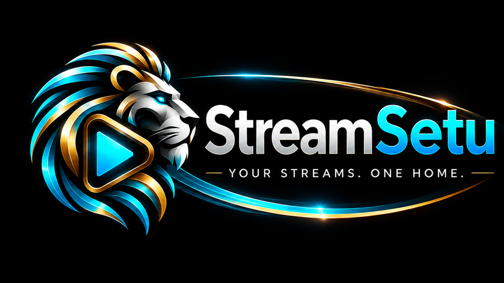
</p>

# StreamSetu

**Your streams. One home.**

StreamSetu is a native player for the IPTV playlists and media servers you already have. It runs on **Mac, iPhone and iPad, Fire TV and Android TV**, keeps everything on your own device, and has no account, no advertising and no analytics.

> StreamSetu is a player only. It provides **no channels, movies, series or subscriptions**, and it does not ship or link to any content. You bring your own legally obtained playlist or login.

## Screenshots

### Mac

<table>
  <tr>
    <td width="50%" valign="top">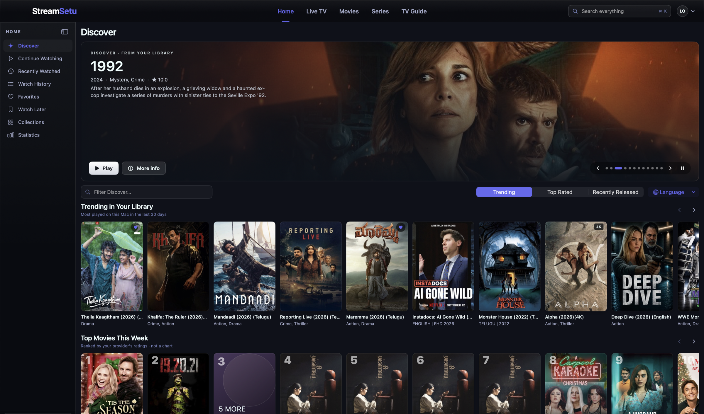</td>
    <td width="50%" valign="top">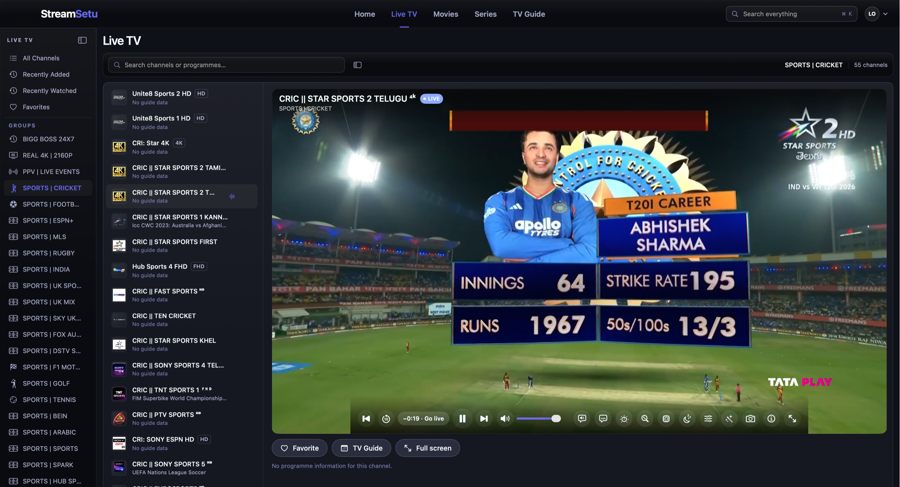</td>
  </tr>
  <tr>
    <td align="center"><sub>Home</sub></td>
    <td align="center"><sub>Live TV</sub></td>
  </tr>
  <tr>
    <td width="50%" valign="top">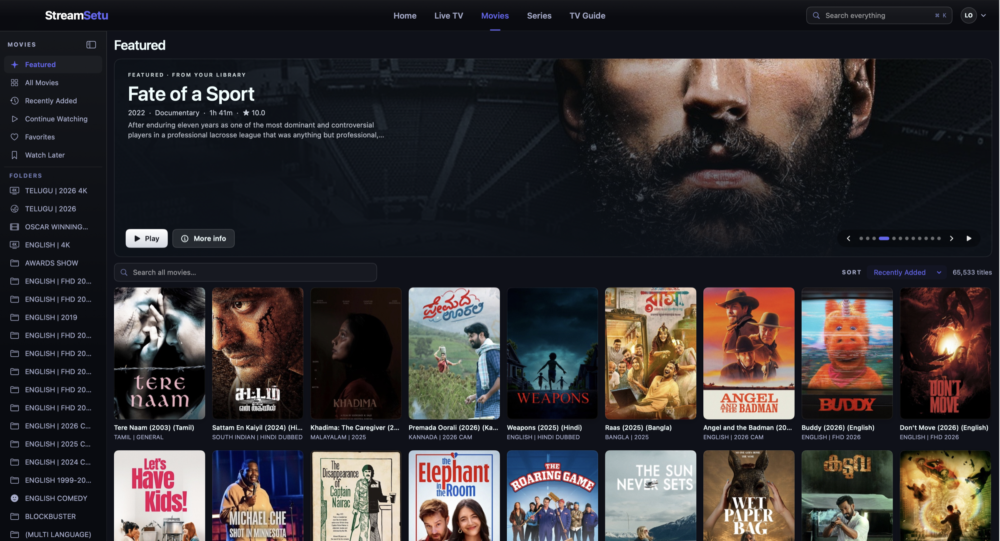</td>
    <td width="50%" valign="top">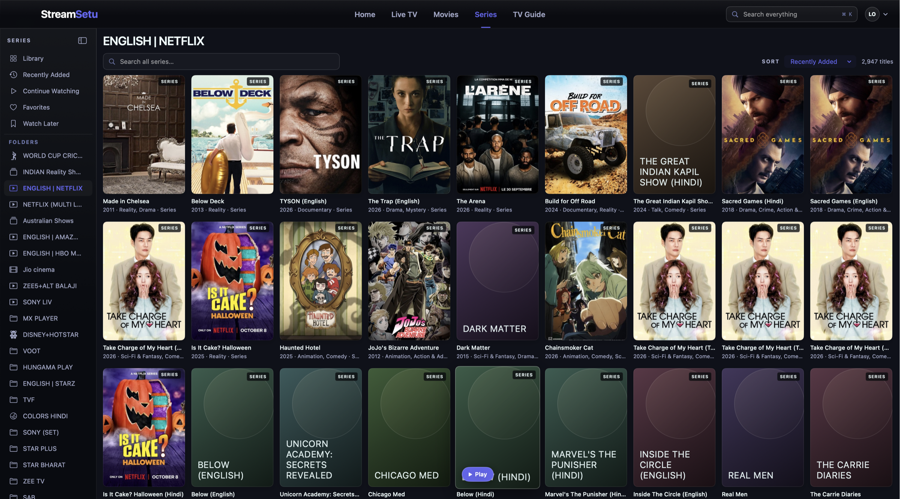</td>
  </tr>
  <tr>
    <td align="center"><sub>Movies</sub></td>
    <td align="center"><sub>Series</sub></td>
  </tr>
</table>

### Fire TV and Android TV

<table>
  <tr>
    <td width="50%" valign="top">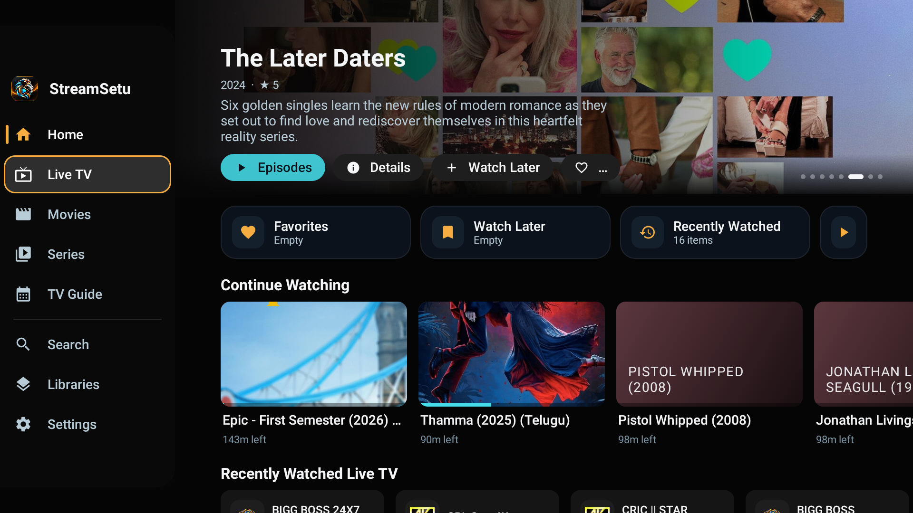</td>
    <td width="50%" valign="top">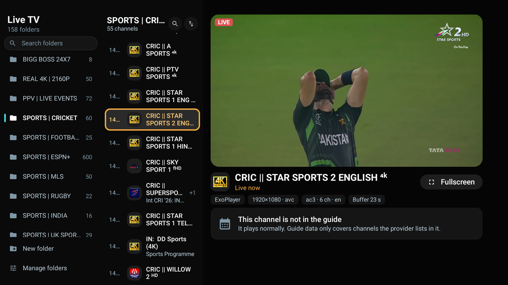</td>
  </tr>
  <tr>
    <td align="center"><sub>Home, sidebar open</sub></td>
    <td align="center"><sub>Live TV</sub></td>
  </tr>
  <tr>
    <td width="50%" valign="top">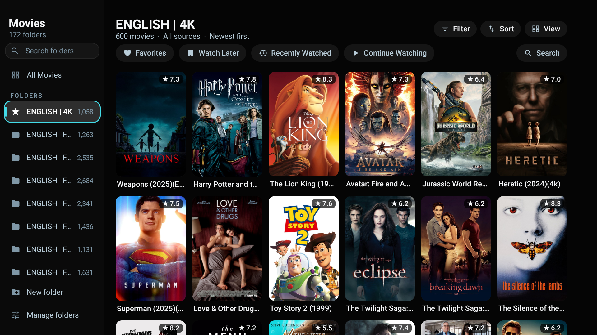</td>
    <td width="50%" valign="top">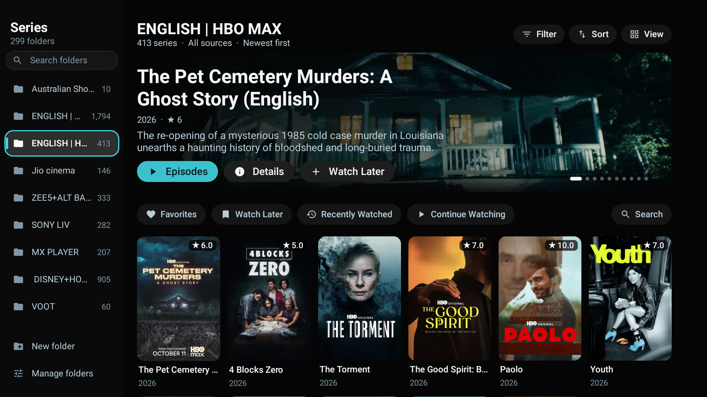</td>
  </tr>
  <tr>
    <td align="center"><sub>Movies</sub></td>
    <td align="center"><sub>Series</sub></td>
  </tr>
</table>

### Android phone

<table>
  <tr>
    <td width="25%" valign="top">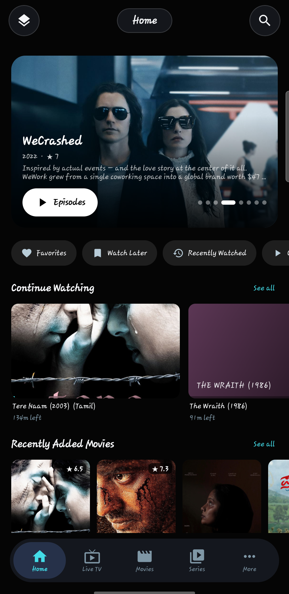</td>
    <td width="25%" valign="top">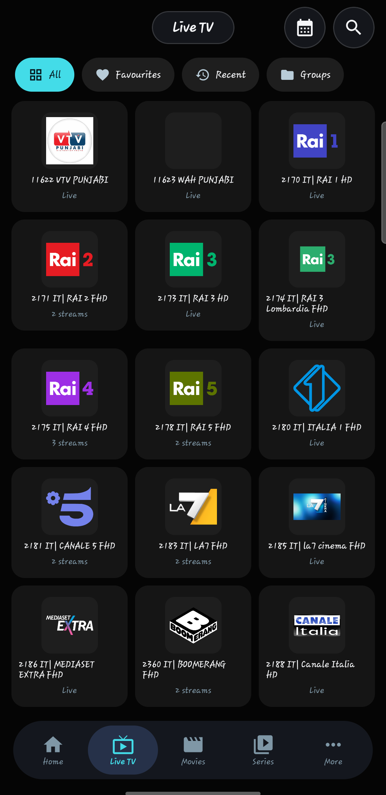</td>
    <td width="25%" valign="top">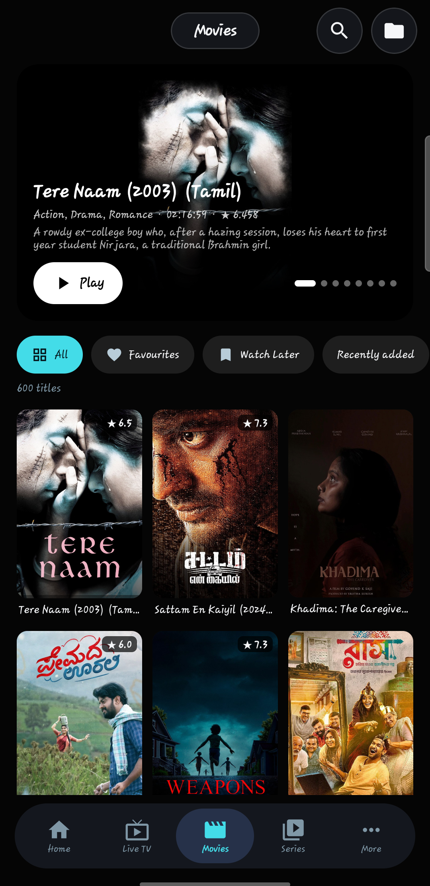</td>
    <td width="25%" valign="top">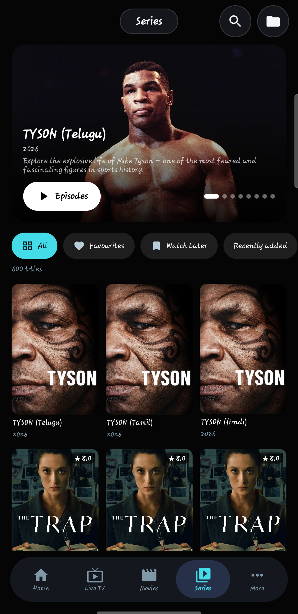</td>
  </tr>
  <tr>
    <td align="center"><sub>Home</sub></td>
    <td align="center"><sub>Live TV</sub></td>
    <td align="center"><sub>Movies</sub></td>
    <td align="center"><sub>Series</sub></td>
  </tr>
</table>

### iPhone

<table>
  <tr>
    <td width="25%" valign="top">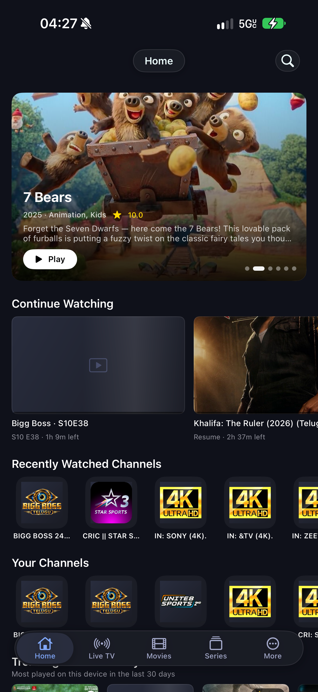</td>
    <td width="25%" valign="top">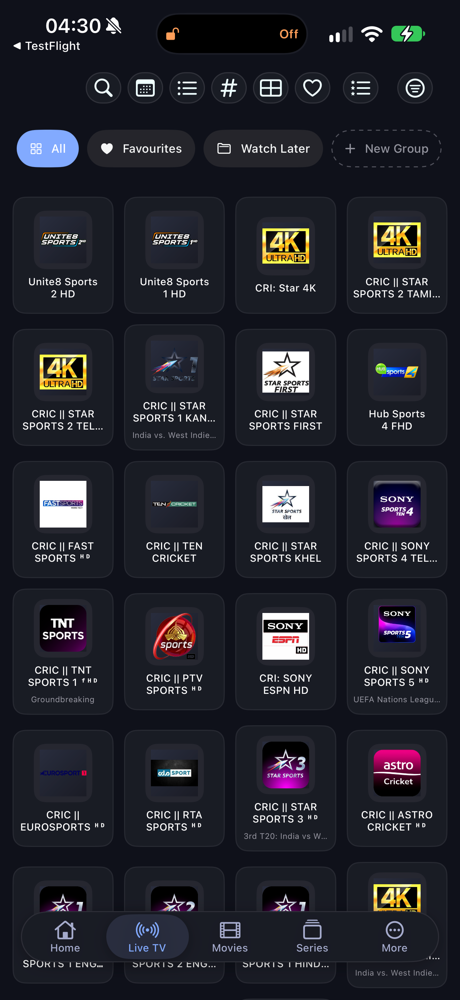</td>
    <td width="25%" valign="top">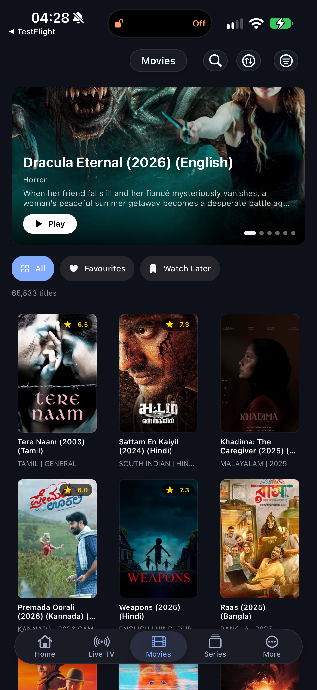</td>
    <td width="25%" valign="top">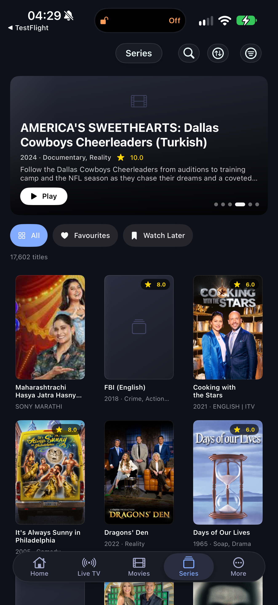</td>
  </tr>
  <tr>
    <td align="center"><sub>Home</sub></td>
    <td align="center"><sub>Live TV</sub></td>
    <td align="center"><sub>Movies</sub></td>
    <td align="center"><sub>Series</sub></td>
  </tr>
</table>

The artwork in these screenshots comes from the provider's own playlist. StreamSetu ships no content.

## Download

| Platform | What to get | Notes |
|---|---|---|
| **Mac** | `StreamSetu-x.y.z.dmg` from [Releases](../../releases) (look for `mac-v…`) | Signed and notarized by Apple. Updates itself. Apple silicon and Intel. |
| **Fire TV and Android TV** | [`StreamSetu-FireTV-0.6.2.apk`](../../releases/download/android-v0.6.2/StreamSetu-FireTV-0.6.2.apk) | Signed with the StreamSetu release key. Remote layout. Android 5.1 or later. |
| **Android phone and tablet** | [`StreamSetu-Android-0.6.2.apk`](../../releases/download/android-v0.6.2/StreamSetu-Android-0.6.2.apk) | Signed with the same key. Touch layout. Android 5.1 or later. |
| **iPhone and iPad** | TestFlight | Ask for an invitation at contact@lokeshreddy.dev. |

The two Android files hold the same build, listed separately so each device has its own download. The app picks the remote or touch layout by itself. Every download has a SHA-256 checksum in its release notes. Verify it with `shasum -a 256 <file>`.

Later releases are on the [Releases](../../releases) page (look for `android-v…`).

### Installing on Android phone or tablet

1. Download `StreamSetu-Android-0.6.2.apk` on the phone.
2. Open it and, when asked, allow installs from your browser or files app.
3. Open StreamSetu.

### Installing on Fire TV

1. On the Fire TV: **Settings → My Fire TV → Developer options**, then turn on **Install unknown apps** for the app you will use to download (for example Downloader).
2. Open that app, enter the APK's address from the Releases page, and install.
3. Open StreamSetu from **Your Apps & Channels**.

If you installed an earlier test build, uninstall it first: test builds before 0.5.0 were signed with a different key, and Android will not install an update signed with another key.

## Getting around

### Android phone and tablet

The Android app detects a phone or tablet and shows a touch layout, laid out like the iPhone app: a floating tab bar (Home, Live TV, Movies, Series, More), a banner you can tap, folder and list chips, poster and channel grids, and sheets that slide up for menus. Touch and hold a title for its menu. The player turns with the phone: tap the picture to show the controls, double-tap the left or right side to skip, drag the bar to seek, swipe up or down on the left for brightness and on the right for volume. A Fire TV or Android TV keeps the remote layout below.

### Fire TV and Android TV remote

| Press | What happens |
|---|---|
| **Back** on a page | Opens the sidebar (Home, Live TV, Movies, Series, TV Guide, Search, Libraries, Settings). On Home the sidebar is always there as a narrow icon strip. |
| **Up / Down** in the sidebar | Moves between sections. Nothing opens until you press OK. |
| **OK** on a section | Opens it, hides the sidebar and puts the cursor on that page's folder list. |
| **Right** from the folders | Moves into the channels, posters or episodes. **Left** goes back to the folders. |
| **OK** on a poster or channel | Opens its detail page, or plays a channel. |
| **Hold OK** (about half a second) | The menu for what's under the cursor: favorite, Watch Later, mark watched, pin, hide, move, lock, rename, and the like. |
| **Back** inside a page | One step up: close the menu, leave the detail page, return to the folders, then the sidebar, then Home. On Home, Back goes to the sidebar first, and one more Back returns to the library chooser. |

**Libraries.** The first screen lists your connections. Pick one and choose **Open Library**. **Manage Library** edits or removes it, and **Add another** or the Quick Add buttons set up Xtream Codes, M3U, a local file or a combined library. Choose **Libraries** in the sidebar to come back here.

**Folders.** Every folder is a provider category. Hold OK on a folder to reorder it, hide it, lock it with a PIN, favorite it, pin it to the top, or rename it. Your changes stay on this device and never change the provider's playlist. **New folder** makes a collection of your own. The shortcut chips above the posters (Favorites, Watch Later, Recently Watched, Continue Watching) show those lists for the current section.

**Search.** Choose **Search** in the sidebar, or the Search chip on a page. Type with the on-screen keyboard, or scan the QR code and type on your phone.

### While something is playing

| Press | Movies and episodes | Live TV |
|---|---|---|
| **OK** | Show the controls, or pause and resume | Show the controls |
| **Left / Right** | Skip back or forward (10 seconds by default, changeable in Settings) | Left opens the channel list |
| **Up / Down** | Down moves to the buttons along the bottom | Next or previous channel |
| **Number keys** | | Type a channel number and wait a moment |
| **Menu or Info** | Opens the More panel: start over, sleep timer, stream information, picture in picture, close player | The same, plus favorite and last channel |
| **Play/Pause, Fast-forward, Rewind, Next, Previous** | Work as on any media remote | Next and Previous change channel |
| **Back** | Asks "Stop watching?" so a stray press doesn't end the film. Choose Continue watching or Exit the player. | Same |

The buttons along the bottom open the episode list, channel list, audio and subtitles, speed, picture shape and which player (ExoPlayer or mpv) is in use. Press **Up** to return to the picture. If a stream does not play, the screen offers **Try Again**, **Next Channel** and **Close**.

### Mac

The top bar switches between Home, Live TV, Movies, Series and TV Guide, and each section has its own list on the left. Keyboard shortcuts (the full list is under **Cmd+/**, Keyboard Shortcuts):

| Keys | Action |
|---|---|
| **Cmd+1 to 5** | Switch section |
| **Cmd+K** | Search everything |
| **Cmd+F** | Search within the current screen |
| **Cmd+N** | Add a playlist |
| **Cmd+O** | Open a video file |
| **Cmd+R** | Refresh all playlists |
| **Cmd+Shift+M** | Open Multi-View |

### iPhone and iPad

Use the tab bar at the bottom: Home, Live TV, Movies, Series and More. Tap a poster for its page, and use the buttons at the top for search, sorting and filters.

## What each app does

A tick means the app has it today. A dash means it does not have it yet. The table was checked against the code of each app, and a feature I could not confirm for every app is left out rather than guessed. Features marked † are built and pass their tests but have not yet been tried against real equipment (a Jellyfin, Emby or Plex server, a tuner or receiver, a WebDAV share, a Chromecast), so they may need small fixes. On the Android phone the TV Guide is a list of channels with what is on now and next, not the full grid.

| | Mac | iPhone | iPad | Android phone / tablet | Fire TV / Android TV |
|---|:-:|:-:|:-:|:-:|:-:|
| **Connections** | | | | | |
| Xtream Codes login | ✓ | ✓ | ✓ | ✓ | ✓ |
| M3U link | ✓ | ✓ | ✓ | ✓ | ✓ |
| M3U file from the device | ✓ | ✓ | ✓ | ✓ | ✓ |
| Stalker / Ministra portal | ✓ | ✓ | ✓ | ✓ (live) | ✓ (live) |
| Jellyfin, Emby, Plex | ✓ | ✓ | ✓ | ✓ † | ✓ † |
| HDHomeRun, TVHeadend, Enigma2 | ✓ | ✓ | ✓ | ✓ † | ✓ † |
| WebDAV server and local video files | ✓ | ✓ | ✓ | ✓ † | ✓ † |
| Custom User-Agent per connection | ✓ | ✓ | ✓ | ✓ | ✓ |
| Extra request headers per connection, and a proxy | ✓ | ✓ | ✓ | ✓ | ✓ |
| **Watching** | | | | | |
| Live TV with groups and channel numbers | ✓ | ✓ | ✓ | ✓ | ✓ |
| TV Guide (XMLTV) | ✓ | ✓ | ✓ | ✓ | ✓ |
| Catch-up for past programmes | ✓ | ✓ | ✓ | ✓ | ✓ |
| Radio mode | ✓ | ✓ | ✓ | ✓ | ✓ |
| Movies and series with resume and Up Next | ✓ | ✓ | ✓ | ✓ | ✓ |
| Multi-View (several channels at once) | ✓ | ✓ | ✓ | ✓ | ✓ † |
| Picture in Picture | ✓ | ✓ | ✓ | ✓ | – |
| AirPlay | ✓ | ✓ | ✓ | – | – |
| Chromecast | – | – | – | ✓ † | – |
| Sound keeps playing in the background, with lock-screen controls and a mini player | – | ✓ | ✓ | ✓ | – |
| Sleep timer | ✓ | ✓ | ✓ | ✓ | ✓ |
| Skip intro | – | – | – | ✓ † | ✓ † |
| Subtitles from a file, and subtitle and sound timing | ✓ | ✓ | ✓ | ✓ (timing with mpv) | ✓ (timing with mpv) |
| Save a picture of the frame | ✓ | ✓ | ✓ | ✓ | ✓ |
| Programme reminders | ✓ | ✓ | ✓ | ✓ † | ✓ † |
| Swipe to change channel | – | ✓ | ✓ | – | – |
| Touch gestures in the player (double-tap skip, brightness, volume) | – | ✓ | ✓ | ✓ | – |
| Player engines | AVPlayer + mpv | AVPlayer + mpv | AVPlayer + mpv | ExoPlayer + mpv | ExoPlayer + mpv |
| **Your library** | | | | | |
| Favorites, Watch Later, Recently Watched, Continue Watching | ✓ | ✓ | ✓ | ✓ | ✓ |
| Collections of your own | ✓ | ✓ | ✓ | ✓ | ✓ |
| Folders: reorder, hide, rename, PIN lock | ✓ | ✓ | ✓ | ✓ | ✓ |
| Search that works offline | ✓ | ✓ | ✓ | ✓ | ✓ |
| New-episode badge on series you watch | ✓ | ✓ | ✓ | ✓ | ✓ |
| Smart lists: Unwatched, Unwatched favorites, Added in 30 days | ✓ | ✓ | ✓ | – | – |
| All playlists together (Apple) / Combined libraries (Android) | ✓ | ✓ | ✓ | ✓ | ✓ |
| Hide, rename and check channels (Channel Manager, health check) | ✓ | ✓ | ✓ | ✓ | ✓ † |
| Watch statistics | ✓ | ✓ | ✓ | ✓ | ✓ |
| Artwork and details from TMDB (your own API key) | ✓ | ✓ | ✓ | ✓ | ✓ |
| Parental controls | ✓ | ✓ | ✓ | ✓ | ✓ |
| Themes and accent colours | ✓ | ✓ | ✓ | ✓ | ✓ |
| Screen reader labels | ✓ | ✓ | ✓ | ✓ (phone) | – |
| Hindi and Telugu (the main screens; some text is still English) | ✓ † | ✓ † | ✓ † | ✓ | ✓ † |
| **Sync and updates** | | | | | |
| iCloud sync between your Apple devices | ✓ | ✓ | ✓ | – | – |
| Backup and restore, and automatic weekly backups | ✓ | ✓ | ✓ | ✓ | ✓ |
| Refresh playlists when the app opens | ✓ | ✓ | ✓ | ✓ | ✓ |
| Refresh while the app is closed | – | ✓ (iOS decides when) | ✓ (iOS decides when) | ✓ (optional) | ✓ (optional) |
| Siri and Shortcuts | – (use Open URL links) | ✓ | ✓ | – | – |
| `streamsetu://` links: play a channel or movie, search, open a tab, pause, resume, sleep | ✓ | ✓ | ✓ | play and search | play and search |
| "Continue watching" row on the Android TV home screen | – | – | – | – | ✓ (Android TV; not Fire TV) |
| Updates itself | ✓ (Sparkle) | TestFlight | TestFlight | ✓ (checks GitHub, asks before installing) | ✓ (checks GitHub, asks before installing) |

The iPad runs the iPhone app, laid out for the larger screen. On the Apple apps, Picture in Picture and AirPlay work for streams AVPlayer plays; a stream played by mpv does not support them. Android phones and tablets run the same app as the Fire TV, with a touch layout chosen automatically when the device is not a television.

### iCloud sync

On the Mac, iPhone and iPad, **iCloud sync** keeps your setup the same on every device signed in to the same Apple ID. It is **off by default**: you turn it on in Settings, under iCloud.

- It carries your playlists, favourites, collections, watch history and resume positions, folder organisation and settings.
- Your playlist logins can travel in iCloud Keychain, which Apple encrypts end to end. There is a separate switch for this, so you can leave logins off and type them on each device instead.
- The data is stored in your own private iCloud, not on our servers. We cannot see it.
- Settings shows the sync status, **Sync Now**, and **Erase iCloud Data** to remove what was stored.
- Android phones, Android tablets and the Fire TV have no iCloud, since it is an Apple service. They keep their data on the device, and can save and restore a backup.

### Each app in a few words

- **Mac**: the full app. A top bar for Home, Live TV, Movies, Series and TV Guide, a list of folders and shortcuts beside each, Cmd+K search, a Multi-View window, a Files screen for local videos and WebDAV servers, a Command Center for managing folders and channels, statistics, and automatic updates.
- **iPhone**: Home, Live TV, Movies, Series and More in a tab bar. A full player with Picture in Picture, AirPlay, swipe to change channel, catch-up, radio mode, sleep timer and a mini player. Multi-View, reminders for programmes, Siri and Shortcuts ("Play BBC One in StreamSetu"), backups, and iCloud sync.
- **iPad**: the iPhone app on a larger screen, with the same features.
- **Android phone and tablet**: the iPhone layout in a touch design. Poster and channel grids, sheets for menus, folder chips, a banner, and a player you tap, drag and swipe, which turns with the phone. Sound keeps playing when you leave the app, with controls on the lock screen and a mini player; it can also cast to a Chromecast.
- **Fire TV and Android TV**: made for the remote. A sidebar that opens with Back, folders beside the content, hold OK for a menu, a Live TV browser with a live preview, the TV Guide, a player with number keys for channels, and quiet interface sounds.

## Fire TV and Android in detail

### Connect your own sources

- **Xtream Codes**: server, user name and password.
- **M3U playlists**: a web link, or a file from the device or a USB drive.
- **Stalker / Ministra portals**: portal address and the MAC address of the box it should act as. Live TV only for now.
- **Jellyfin and Emby** (movies and series; server, user name and password) and **Plex** (movies and shows; server and access token). The password is kept in the system's secure storage; the sign-in token is renewed by itself.
- **HDHomeRun tuners**, **TVHeadend** servers and **Enigma2 receivers** on your own network (live channels; the guide comes from TVHeadend's own XMLTV).
- **WebDAV shares** (a NAS or cloud drive) and **a folder of videos on the phone**: video files appear as movies, by folder.
- **Extra request headers** per connection (one per line, written as `Name: value || Name: value` in the form), and an app-wide **HTTP or SOCKS proxy** that never touches addresses on your own network.
- A **custom User-Agent** per connection, for providers that insist on a particular player.
- **Combined libraries**: several connections shown as one library, without copying anything. A title that exists in two connections is one title to you; you choose which connection plays it.
- **Test before you save**: a connection is tried once, by hand, with no automatic retries. A login that works but returns nothing is rejected, and an unfinished setup is kept as a draft you can come back to.
- **Phone setup** (Fire TV): scan a QR code, type the connection on your phone, approve it on the TV. The link works for five minutes, on your home network only.

### Watch

- **Sound in the background** (phones): when you leave the app, what is playing carries on as sound, with controls on the lock screen and in the notification shade. Back from a radio station keeps it playing under a mini player; the down arrow in the player does the same for anything.
- **Multi-View**: up to four live channels on one screen, sound from one. A provider that allows one connection plays only one of them, and the screen says so.
- **Skip intro**: a button in the first minutes of an episode. The first time you jump forward early in a series it learns where that series' opening ends.
- **Sleep timer**, **subtitles from a file**, **subtitle and sound timing** (mpv), and **a picture of the frame** saved to Pictures/StreamSetu.
- **Programme reminders** from the TV Guide: a notification a minute before it starts, which opens the channel.
- **Live TV** with channel groups, channel numbers, a three-column browser (folders, channels, live picture), fullscreen, last-channel recall, and typing a channel number.
- **TV Guide** from XMLTV: a timeline grid, programme details, a "now" line, and matching by the provider's guide id or by channel name when ids are missing. A time shift for providers whose guide runs early or late.
- **Catch-up** for channels where the provider offers an archive.
- **Movies and series** with fullscreen detail pages, story and cast from the provider, seasons and episodes, resume, "Start over", "Up next", and a "Continue Forward" or "Catch Up" choice when you skipped an episode. Autoplay never runs across a missing episode.
- **Radio**: stations marked `radio="true"` (or in a Radio category) play with an audio-only screen.
- **Resume anywhere**: progress is saved only after a picture has really played, and a failed seek can never overwrite your earlier position.

### Find things fast

- **Folders** are the provider's own categories. You can search them, favorite, pin, reorder (up, down, first, last), hide, lock behind a PIN, give them a display name, and reset any of it. Nothing you do changes the provider's playlist; it is all stored on your device.
- **Collections** of your own, and a shortcut row for Favorites, Watch Later, Recently Watched and Continue Watching.
- **Channel Manager** (Settings): hide channels, rename them, tie one to another guide channel, and check which channels answer (a channel that does not answer in time is never counted as dead). Your changes survive a refresh of the playlist.
- **Statistics**: how long you watched, by day and hour, and your most watched channels, movies and series. It stays on the device and can be cleared.
- **Artwork from TMDB**: with your own free API key, pictures and descriptions your provider left out are filled in.
- **Themes and accent colours**, and **Hindi and Telugu** for the main screens (Settings, Appearance, Language). Text that has no translation yet stays in English; titles and descriptions always come from your provider.
- **Search** runs on a local text index, so it works offline. It reads queries the way you mean them ("hindi movies 2024" is Hindi titles from 2024), fixes a misspelt word from the words in your own library when nothing matches and says what it searched for, and groups results as Live TV, Movies, Series, Episodes, TV Guide programmes, Folders and Collections. It keeps recent searches for each screen. The iPhone, iPad, Mac, Android phone and Fire TV apps all search this way.
- **Sorting** only offers orders the catalog can truly support (recently added, A–Z, release year, rating, recently watched, new episodes first…), remembered per section and per folder.

### Playback you can trust

- **Two engines**: Media3 ExoPlayer for HLS, MP4, DASH and MPEG-TS, and mpv for MKV, AVI and unusual formats. Automatic chooses per stream; if a format fails it tries the other engine once. Switching engine retries the *same* stream; a different provider stream is only ever your choice.
- **Recovery**: a stream stuck loading is treated as failed; failures are sorted into network, login, copy-protection, decoder and format problems, and only the relevant action is offered.
- **One-connection providers** are respected: a new stream waits for the old one to close.
- **Separate buffering** for Live TV and for movies, with per-connection overrides.
- **Stream details** on screen: engine, resolution, codecs, buffer, dropped frames.

### Built for the remote

- Everything works with a Fire TV remote: arrows, OK, **hold OK for a menu**, Back, and digits.
- Back always goes one step up: close a menu → leave a page → folders → sidebar → Home → library chooser.
- Smooth, restrained motion with one shared set of timings; reduced-motion is respected.
- Optional soft **interface sounds** (original tones, off by default during playback volume rules, never touching the TV's volume).

### Privacy and safety

- The Android apps can check GitHub for a newer release (Settings, About, Updates). It is on by default, runs once a day, and only when nothing is playing. Only the public release list is requested, and nothing about you is sent. A downloaded file is used only if its checksum matches the release notes and it is signed with the same key as the installed app, and the system installer always asks you to confirm. You can turn the check off.
- No account, no advertising, no analytics, no crash reporting sent anywhere.
- Logins live in the system's secure storage (Android Keystore, Apple Keychain) and are never shown, logged or exported.
- Diagnostic reports and backups remove addresses, user names, passwords and tokens.
- Folder locks are a real PIN lock: the PIN is stored only as a salted hash, and locked titles are also left out of search and banners.
- Backups hold favorites, folder arrangements, progress and settings, never logins or playlist links.

## Platforms and compatibility

| | Mac | iPhone and iPad | Android phone / tablet and Fire TV / Android TV |
|---|---|---|---|
| Language | Swift, SwiftUI, AppKit | Swift, SwiftUI | Kotlin, Jetpack Compose |
| Players | AVPlayer and mpv | AVPlayer and mpv (MPVKit) | Media3 ExoPlayer and mpv |
| Formats | HLS and MP4 through AVPlayer; MKV, AVI, DASH, RTSP and unusual codecs through mpv | The same as the Mac | HLS, MP4, DASH and MPEG-TS through ExoPlayer; MKV, AVI and unusual formats through mpv |
| Minimum | macOS 14 | iOS 18 | Android 5.1 (mpv needs Android 8) |

The Fire TV app has been developed and tested on a Fire TV Stick 4K (Fire OS 7). The Android phone layout has been tried on one Samsung phone running Android 16. Other devices should work but have not all been tested.

## Repository layout

| Folder | Contents |
|---|---|
| `macos/` | The Mac app and the release scripts (build, sign, notarize, publish, update feed) |
| `ios/` | The iPhone and iPad app (shares most code with the Mac app) |
| `android/` | The Fire TV and Android TV app |
| `web/` | The website and privacy pages |
| `legal/` | Privacy policy and terms |
| `branding/` | Icons and artwork |

### Android modules

```
core-model        data classes, sorting and capability models
core-security     Android Keystore credential store
core-network      HTTP client, M3U / Xtream / XMLTV parsers
core-database     Room database (v5) plus the text-search index
core-preferences  settings and appearance preferences
core-media        playback coordinator, ExoPlayer and mpv engines, recovery policy
core-ui           shared motion timings, reduced-motion handling
data              repositories, sync, EPG, search, Stalker client, backup and maintenance
app               Hilt wiring, navigation, all screens, interface sounds
```

More detail is in [`android/ARCHITECTURE.md`](android/ARCHITECTURE.md), and what is built against each specification is in [`android/SPEC-STATUS.md`](android/SPEC-STATUS.md).

## Building

| Target | Command | Needs |
|---|---|---|
| Android (debug) | `cd android && ./gradlew :app:assembleDebug` | JDK 17, Android SDK |
| Android (tests) | `./gradlew :data:testDebugUnitTest :core-media:testDebugUnitTest :app:testDebugUnitTest` | same |
| Android (signed release) | `cd android && ./release.sh 1.0.0 12` | your own `android/keystore.properties` (storeFile, storePassword, keyAlias, keyPassword). Without it the APK is debug-signed and for testing only. |
| Mac (tests) | `cd macos && Scripts/run-tests.sh` | Xcode command line tools |
| Mac (release) | `cd macos && Scripts/build-release.sh` | libmpv in `macos/third_party/` (not in this repository), a Developer ID certificate, a notarization profile |
| iPhone | scripts in `Scripts/` generate the Xcode project | Xcode, an Apple developer account for devices |

## Known limits

- Stalker portals: live TV only; no movies, series or guide from a portal yet.
- Items marked † in the table are built and covered by unit tests but have not been tried on real equipment yet: Jellyfin, Emby, Plex, HDHomeRun, TVHeadend, Enigma2, WebDAV and Chromecast on Android; Skip intro and reminders on Android; and anything marked † for the Fire TV or the Apple apps, which were not run this time (Hindi and Telugu on Mac and iPhone build and are covered by tests, but their wording has not been looked at on screen). Tried on a Samsung phone: sound in the background, the mini player, lock-screen controls, saving a picture, Multi-View with two streams, Statistics, the Channel Manager and its health check, themes, and Hindi and Telugu.
- A Chromecast fetches the stream itself, so only plain web streams (HLS, MP4) cast well, and a connection that needs special headers cannot be cast.
- The "Continue watching" row on the home screen works on Android TV and Google TV, not on a Fire TV, which has its own home screen.
- Hindi and Telugu cover the main screens and the most common words; long explanations in Settings are still English. The wording was written without a native-speaker review, so corrections are welcome.
- On the Mac, real Siri phrases need an app built with Xcode (App Intents); the Mac build is not, so Shortcuts reaches it through "Open URL" with `streamsetu://` links.
- Refresh-rate matching, audio delay and subtitle delay are not offered on Fire TV.
- Catch-up needs a provider that offers an archive, and some providers read the start time in their own time zone (there is a setting for it).
- The Fire TV app is newer than the Mac and iPhone apps and has had less testing on real devices.

## Support and feedback

contact@lokeshreddy.dev. A diagnostic report (Settings → Diagnostics) contains no logins or provider addresses and is safe to attach.

## Licence and third-party software

The source is published so it can be read. Unless a licence file says otherwise, all rights in StreamSetu's own code and artwork are reserved by the author. StreamSetu uses third-party software under its own licences, including AndroidX Media3 (Apache 2.0), mpv/libmpv (LGPL 2.1 or later, GPL in some builds), OkHttp, Retrofit, Coil, Hilt, Room, ZXing and Sparkle.
