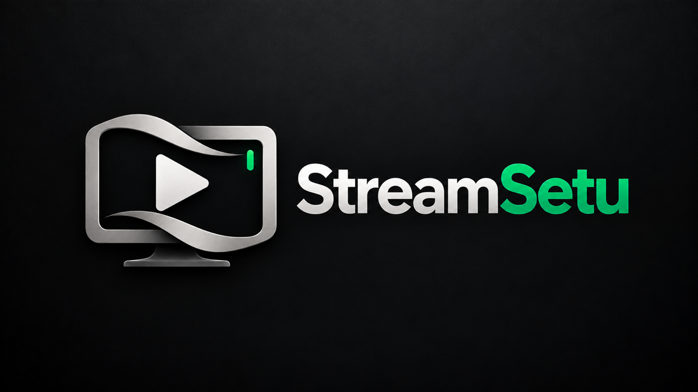
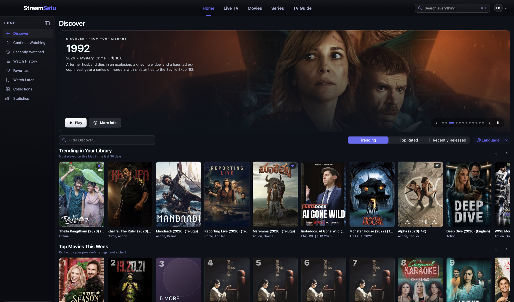
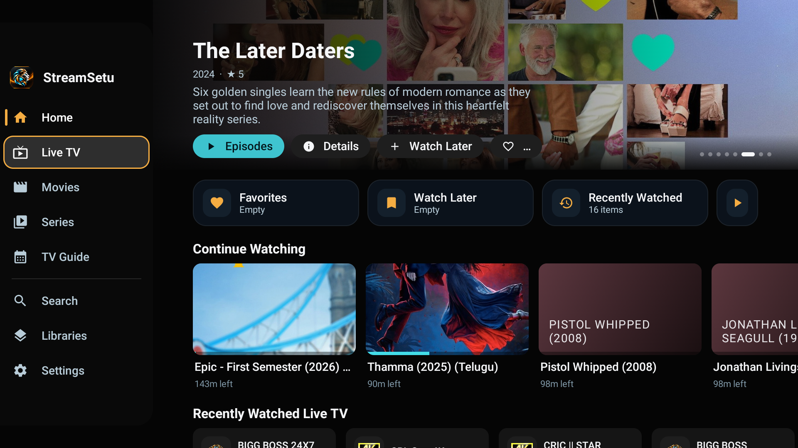
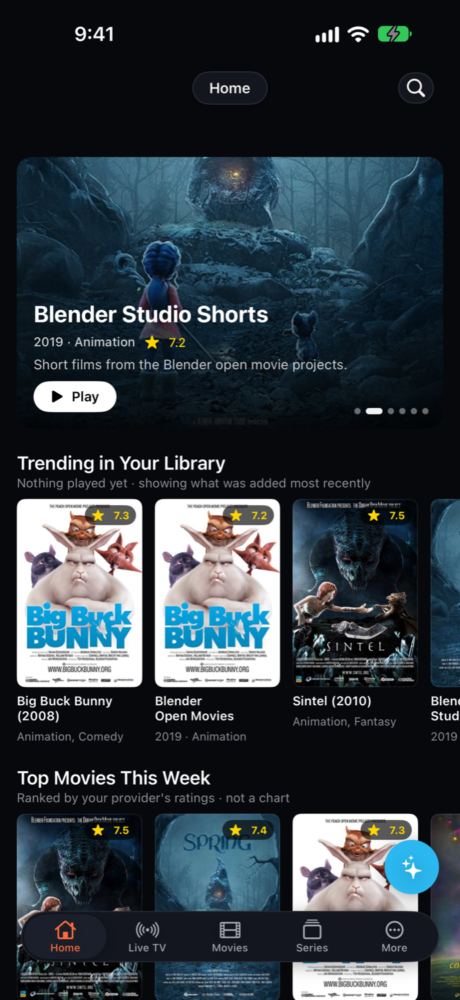
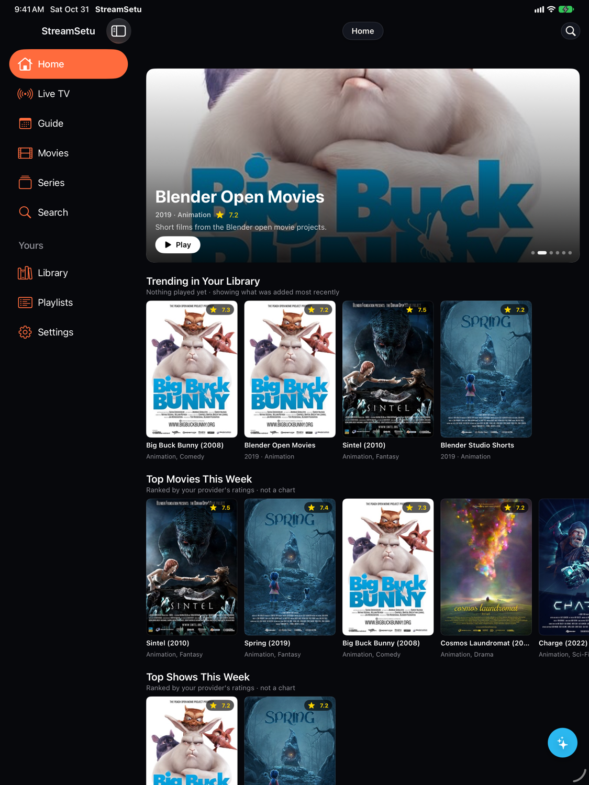
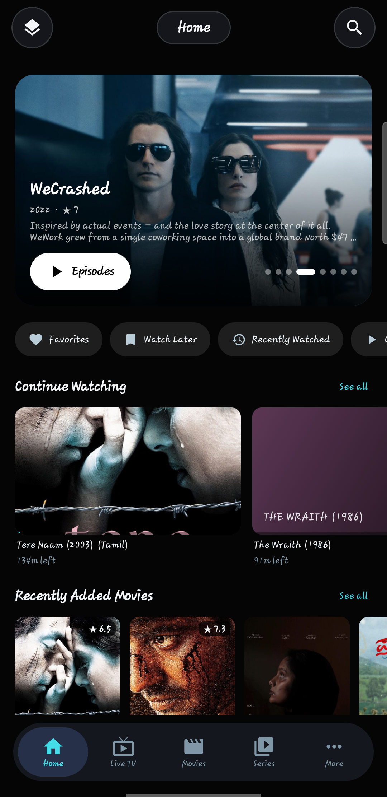

  

# StreamSetu

**Your streams. One home.**

A native player for the IPTV playlists and media servers you already have. It runs on **Mac, iPhone and iPad, Android phones and tablets, Fire TV and Android TV** and Windows, keeps everything on your own device, and needs no account.

> StreamSetu is a player only. It provides **no channels, movies, series or subscriptions** and does not ship or link to any content. You bring your own legally obtained playlist or login.

<table>
  <tr>
    <td width="50%" valign="top"></td>
    <td width="50%" valign="top"></td>
  </tr>
  <tr>
    <td align="center">Mac</td>
    <td align="center">Fire TV and Android TV</td>
  </tr>
</table>

<table>
  <tr>
    <td width="28%" valign="top"></td>
    <td width="44%" valign="top"></td>
    <td width="28%" valign="top"></td>
  </tr>
  <tr>
    <td align="center">iPhone</td>
    <td align="center">iPad</td>
    <td align="center">Android phone</td>
  </tr>
</table>

More pictures: [docs/SCREENSHOTS.md](docs/SCREENSHOTS.md).

## Download

| Platform | What to get | Notes |
|---|---|---|
| **iPhone and iPad** | [Download on the App Store](https://apps.apple.com/us/app/stream-setu/id6821526110), or [join the TestFlight](https://testflight.apple.com/join/wYZ3vysQ), version 1.1 | The App Store has the released version. TestFlight gets new builds first and is open to the first 100 testers; after that, ask for an invitation at contact@lokeshreddy.dev. |
| **Mac** | [`StreamSetu-2.15.1.dmg`](../../releases/download/2026.11.02.1/StreamSetu-2.15.1.dmg), one release holds every app | Signed and notarized by Apple. Updates itself. Apple silicon and Intel. |
| **Fire TV and Android TV** | [`streamsetu-tv-0.23.1.apk`](../../releases/download/2026.11.02.1/streamsetu-tv-0.23.1.apk) | Signed with the StreamSetu release key. Remote layout. Android 5.1 or later. |
| **Android phone and tablet** | [`StreamSetu-Android-0.23.1.apk`](../../releases/download/2026.11.02.1/StreamSetu-Android-0.23.1.apk) | Signed with the same key. Touch layout. Android 5.1 or later. |
| **Windows** | [`StreamSetu-Windows-0.1.0.zip`](../../releases/download/2026.11.07/StreamSetu-Windows-0.1.0.zip) | Unzip and run `StreamSetu.exe`. Windows 10 (version 1809) or later, 64-bit. |

Every download is on the [Releases](../../releases) page with its SHA-256 checksum (`shasum -a 256 <file>`). Needs macOS 14, iOS 18, Windows 10 or Android 5.1 (the mpv player needs Android 8). How a release is made: [docs/RELEASING.md](docs/RELEASING.md).

**Fire TV:** in **Settings → My Fire TV → Developer options** turn on **Install unknown apps** for Downloader, open Downloader and enter the code **7315299** (or open **aftv.news/7315299** in a browser), install, then open StreamSetu from **Your Apps & Channels**. If you installed a build older than 0.5.0, uninstall it first; it was signed with a different key.

**Android phone or tablet:** download the APK on the phone, open it, allow installs from your browser or files app when asked, then open StreamSetu.

## What it does

- **Connects to what you have:** Xtream logins, M3U links and files, Jellyfin, Emby, Plex, HDHomeRun, TVHeadend, Enigma2, WebDAV and local video files (Stalker portals on Mac, Android and Fire TV).
- **Live TV, the TV Guide and catch-up**, with groups, channel numbers, favourites and your own folders; Multi-View on the apps that have it.
- **Movies and series** with resume, next episode and best-version-first.
- **Fast search** across channels, films, series and the guide.
- **Two players:** Apple's AVPlayer or Android's ExoPlayer for the common formats, and mpv for MKV, AVI, RTSP and unusual codecs.
- **Your data stays with you:** no ads, no analytics, no account. iCloud and Wi-Fi sync are optional. Optional **App DNS** (encrypted DNS for StreamSetu only, not a VPN).
- **Optional extras:** the Setu assistant, Trakt, TMDB artwork with your own key, recording and reminders.

The full feature table for every app is in [docs/FEATURES.md](docs/FEATURES.md).

## Read more

| | |
|---|---|
| [What each app does](docs/FEATURES.md) | The feature table, app by app |
| [Getting around](docs/GETTING-AROUND.md) | The remote, touch and keyboard controls |
| [Fire TV and Android in detail](docs/FIRETV-ANDROID.md) | Sources, playback, search and privacy on TV |
| [Known limits](docs/KNOWN-LIMITS.md) | What an app does not do yet |
| [Building](docs/BUILDING.md) | Folders, build commands and compatibility |
| [Releasing](docs/RELEASING.md) · [Release security](docs/RELEASE-SECURITY.md) | How downloads are made and checked |
| [Privacy policy](legal/privacy.md) · [Terms](legal/terms.md) | Legal |

## Support

contact@lokeshreddy.dev. A diagnostic report (Settings → Diagnostics) contains no logins or provider addresses and is safe to attach.

## Licence

The source is published so it can be read. Unless a licence file says otherwise, all rights in StreamSetu's own code and artwork are reserved by the author. StreamSetu uses third-party software under its own licences, including AndroidX Media3 (Apache 2.0), mpv/libmpv (LGPL 2.1 or later, GPL in some builds), OkHttp, Retrofit, Coil, Hilt, Room, ZXing and Sparkle.
