[← Back to the README](../README.md)

# Screenshots

## Mac

In order, from the opening screen to the end.

<table>
  <tr>
    <td width="50%" valign="top"></td>
    <td width="50%" valign="top">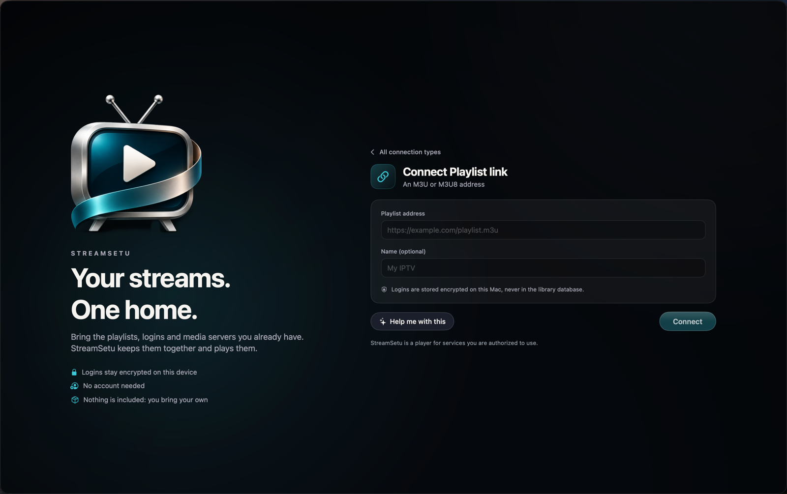</td>
  </tr>
  <tr>
    <td align="center">The opening screen: choose how to connect</td>
    <td align="center">Playlist link</td>
  </tr>
  <tr>
    <td width="50%" valign="top"></td>
    <td width="50%" valign="top"></td>
  </tr>
  <tr>
    <td align="center">Xtream Codes</td>
    <td align="center">Media server</td>
  </tr>
  <tr>
    <td width="50%" valign="top"></td>
    <td width="50%" valign="top">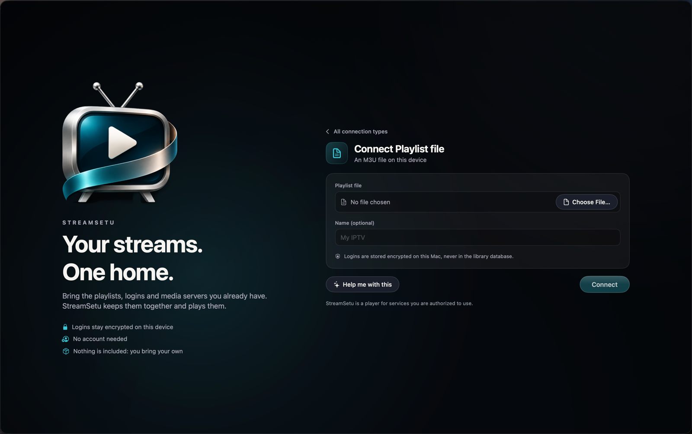</td>
  </tr>
  <tr>
    <td align="center">TV tuner or receiver</td>
    <td align="center">Playlist file</td>
  </tr>
  <tr>
    <td width="50%" valign="top">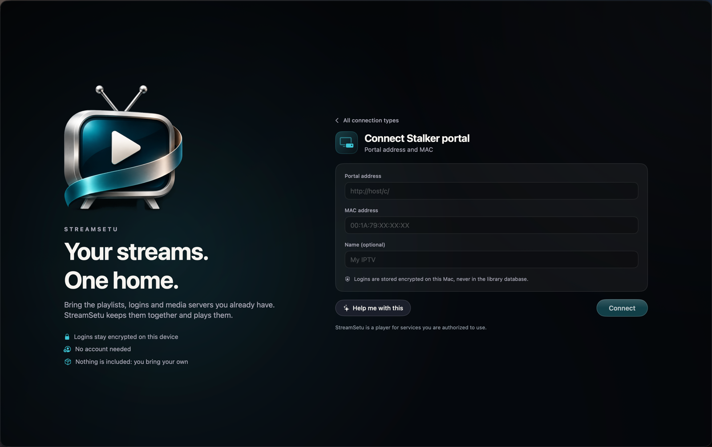</td>
    <td width="50%" valign="top"></td>
  </tr>
  <tr>
    <td align="center">Stalker portal</td>
    <td align="center">Single stream</td>
  </tr>
  <tr>
    <td width="50%" valign="top">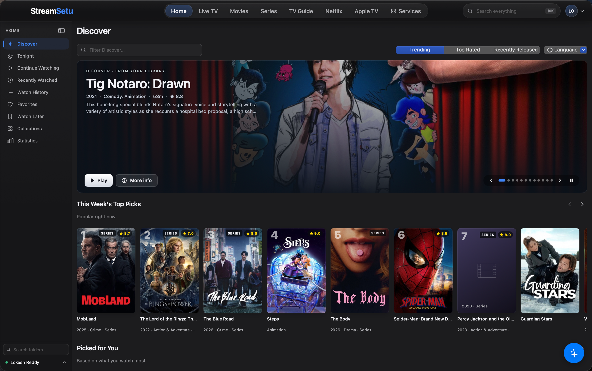</td>
    <td width="50%" valign="top"></td>
  </tr>
  <tr>
    <td align="center">Home</td>
    <td align="center">Live TV</td>
  </tr>
  <tr>
    <td width="50%" valign="top"></td>
    <td width="50%" valign="top"></td>
  </tr>
  <tr>
    <td align="center">Movies</td>
    <td align="center">Series</td>
  </tr>
  <tr>
    <td width="50%" valign="top"></td>
  </tr>
  <tr>
    <td align="center">TV Guide</td>
  </tr>
</table>

## Fire TV and Android TV

<table>
  <tr>
    <td width="50%" valign="top"></td>
    <td width="50%" valign="top"></td>
  </tr>
  <tr>
    <td align="center">Home, sidebar open</td>
    <td align="center">Live TV</td>
  </tr>
  <tr>
    <td width="50%" valign="top"></td>
    <td width="50%" valign="top"></td>
  </tr>
  <tr>
    <td align="center">Movies</td>
    <td align="center">Series</td>
  </tr>
</table>

## Android phone

<table>
  <tr>
    <td width="25%" valign="top"></td>
    <td width="25%" valign="top">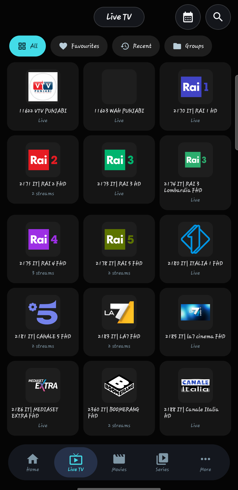</td>
    <td width="25%" valign="top">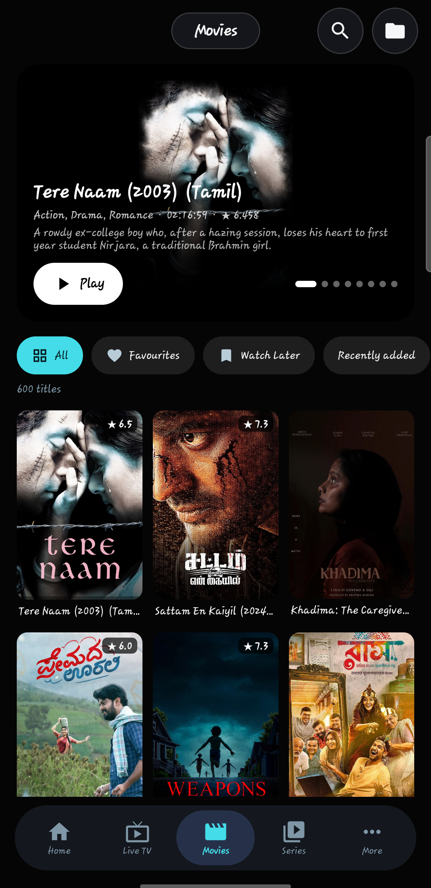</td>
    <td width="25%" valign="top">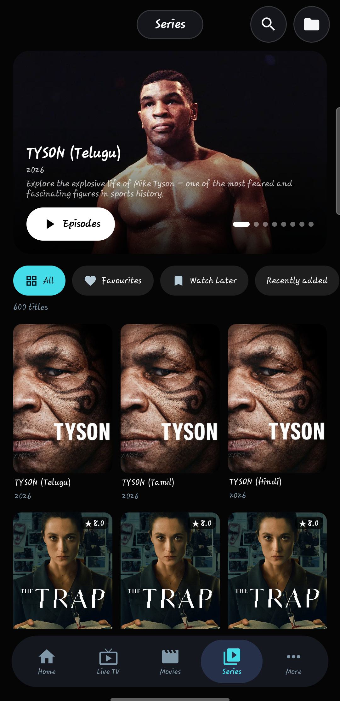</td>
  </tr>
  <tr>
    <td align="center">Home</td>
    <td align="center">Live TV</td>
    <td align="center">Movies</td>
    <td align="center">Series</td>
  </tr>
</table>

## iPhone

In order, from the launch screen to the end, then the menus and more pages.

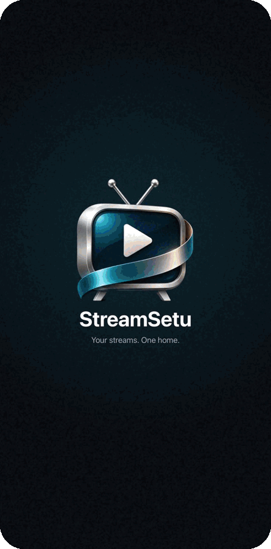

<table>
  <tr>
    <td width="25%" valign="top"></td>
    <td width="25%" valign="top">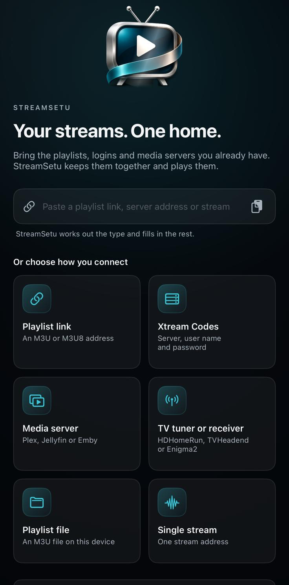</td>
    <td width="25%" valign="top">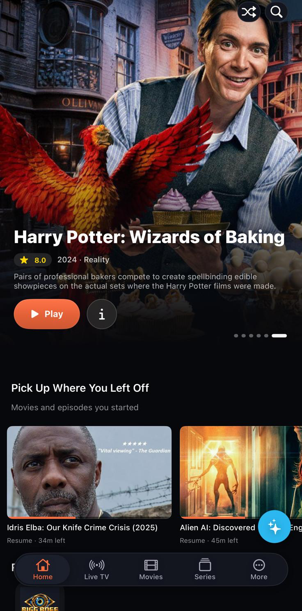</td>
    <td width="25%" valign="top"></td>
  </tr>
  <tr>
    <td align="center" valign="top">Launch screen</td>
    <td align="center" valign="top">Opening screen: choose how to connect</td>
    <td align="center" valign="top">Home</td>
    <td align="center" valign="top">Live TV</td>
  </tr>
  <tr>
    <td width="25%" valign="top">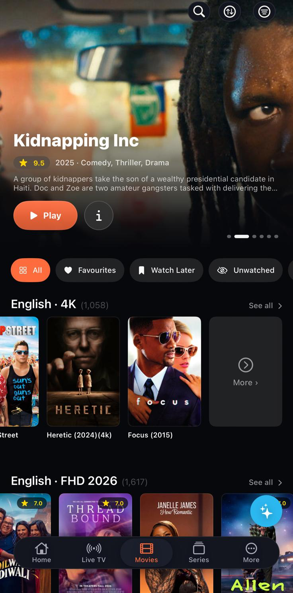</td>
    <td width="25%" valign="top"></td>
    <td width="25%" valign="top"></td>
    <td width="25%" valign="top"></td>
  </tr>
  <tr>
    <td align="center" valign="top">Movies</td>
    <td align="center" valign="top">Title page</td>
    <td align="center" valign="top">Title page: details, cast and more like this</td>
    <td align="center" valign="top">Series title page</td>
  </tr>
  <tr>
    <td width="25%" valign="top"></td>
    <td width="25%" valign="top">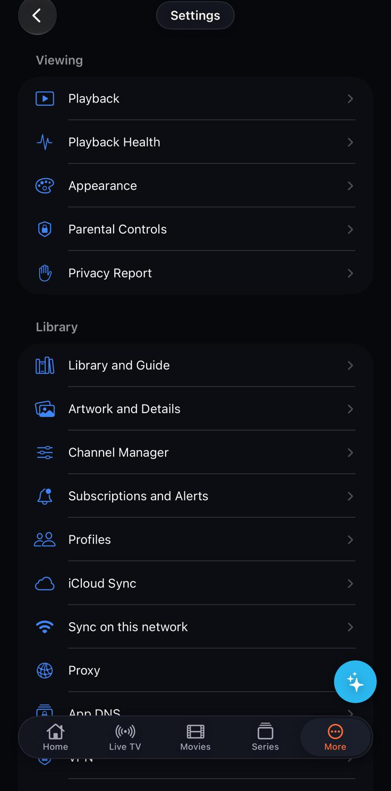</td>
    <td width="25%" valign="top">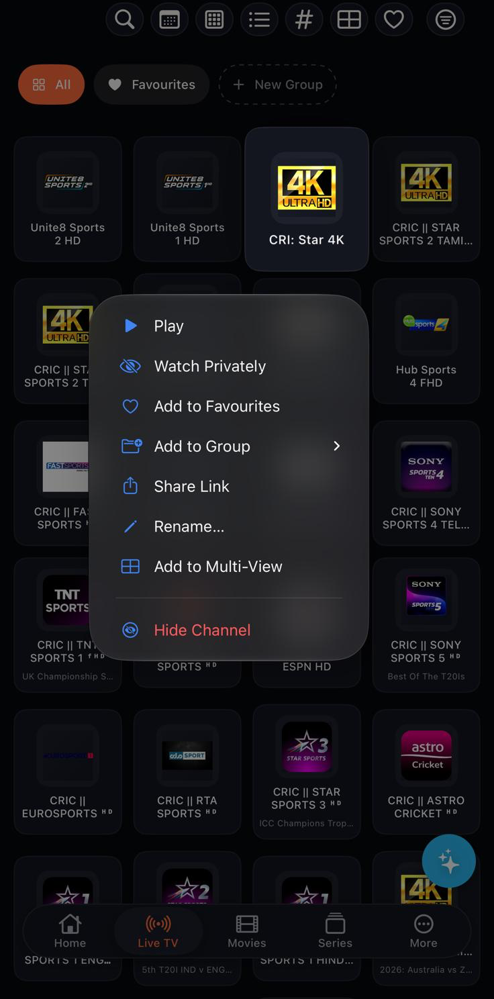</td>
    <td width="25%" valign="top">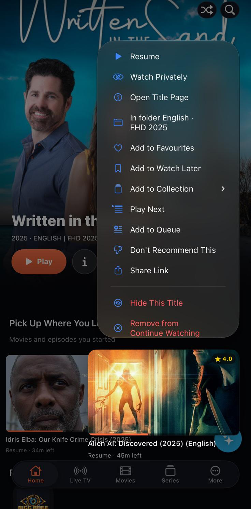</td>
  </tr>
  <tr>
    <td align="center" valign="top">Episodes</td>
    <td align="center" valign="top">Settings</td>
    <td align="center" valign="top">Channel menu</td>
    <td align="center" valign="top">Title menu on Home</td>
  </tr>
  <tr>
    <td width="25%" valign="top"></td>
    <td width="25%" valign="top"></td>
    <td width="25%" valign="top"></td>
  </tr>
  <tr>
    <td align="center" valign="top">Person page</td>
    <td align="center" valign="top">Title page menu</td>
    <td align="center" valign="top">Title menu in Movies</td>
  </tr>
</table>

## iPad

<table>
  <tr>
    <td align="center" valign="top"></td>
  </tr>
  <tr>
    <td align="center">Home</td>
  </tr>
</table>

The artwork in these screenshots comes from the provider's own playlist. StreamSetu ships no content.
