[← Back to the README](../README.md)

# Screenshots

## Mac

<table>
  <tr>
    <td width="50%" valign="top">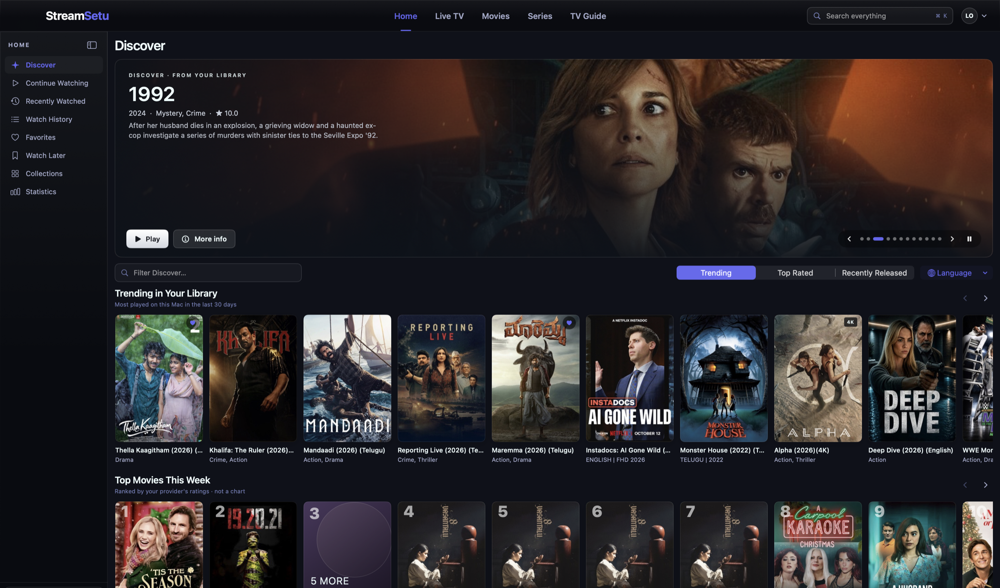</td>
    <td width="50%" valign="top">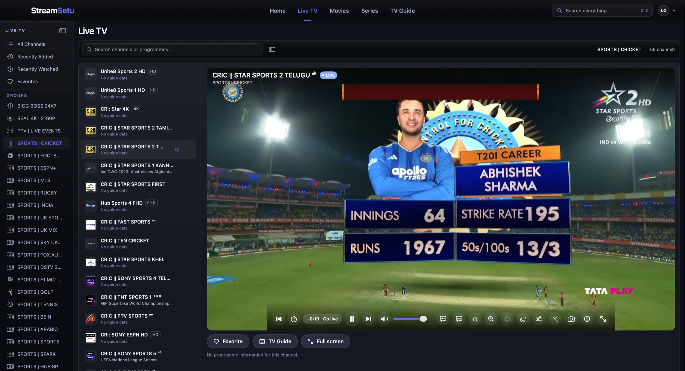</td>
  </tr>
  <tr>
    <td align="center">Home</td>
    <td align="center">Live TV</td>
  </tr>
  <tr>
    <td width="50%" valign="top">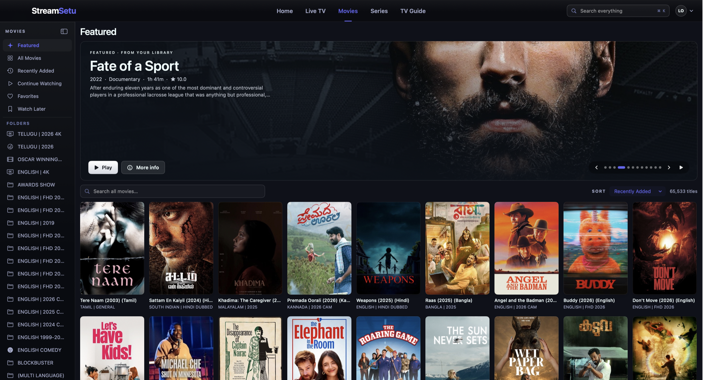</td>
    <td width="50%" valign="top">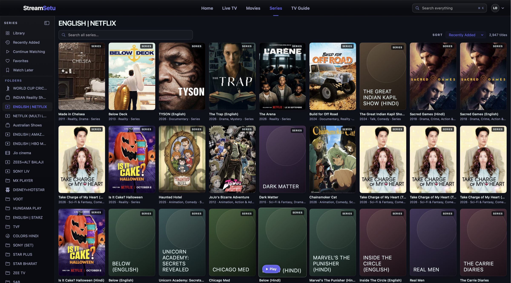</td>
  </tr>
  <tr>
    <td align="center">Movies</td>
    <td align="center">Series</td>
  </tr>
</table>

## Fire TV and Android TV

<table>
  <tr>
    <td width="50%" valign="top">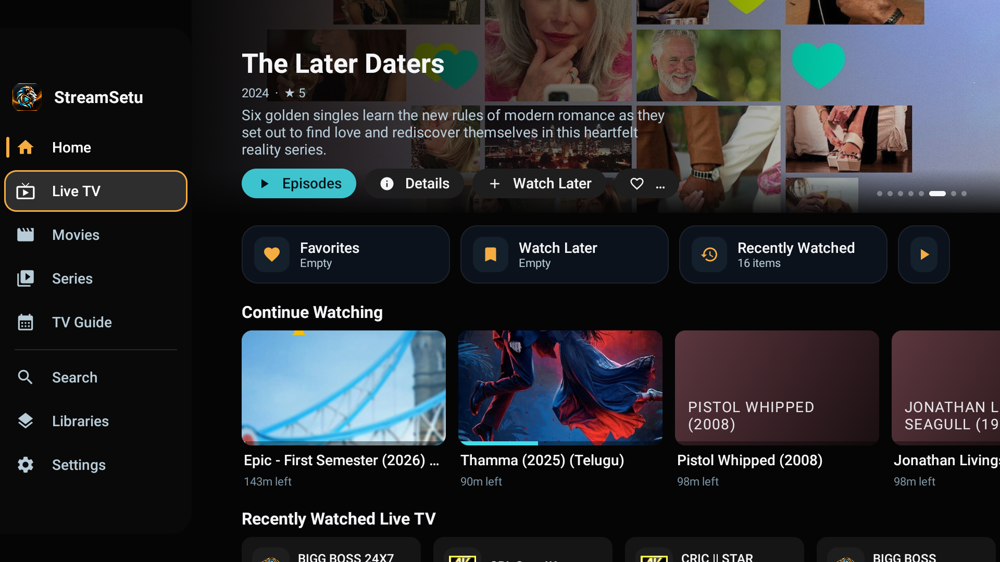</td>
    <td width="50%" valign="top">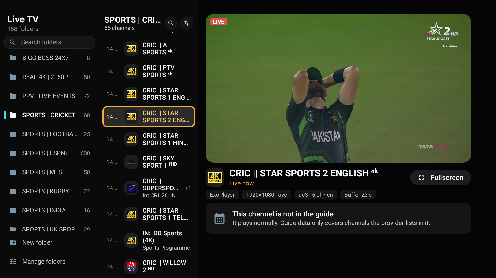</td>
  </tr>
  <tr>
    <td align="center">Home, sidebar open</td>
    <td align="center">Live TV</td>
  </tr>
  <tr>
    <td width="50%" valign="top">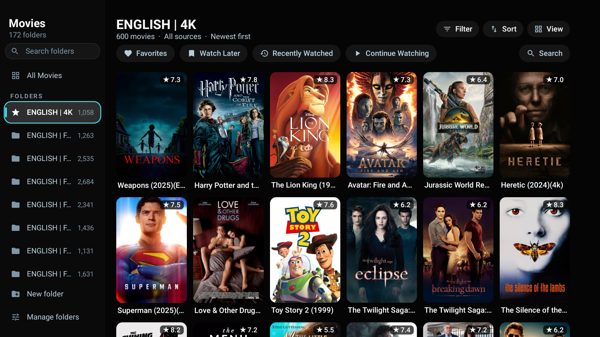</td>
    <td width="50%" valign="top">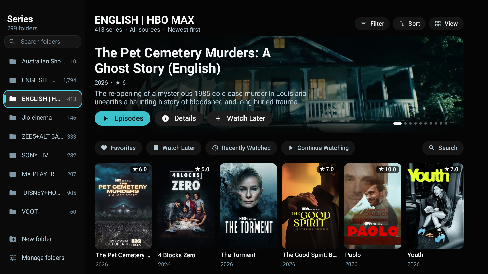</td>
  </tr>
  <tr>
    <td align="center">Movies</td>
    <td align="center">Series</td>
  </tr>
</table>

## Android phone

<table>
  <tr>
    <td width="25%" valign="top">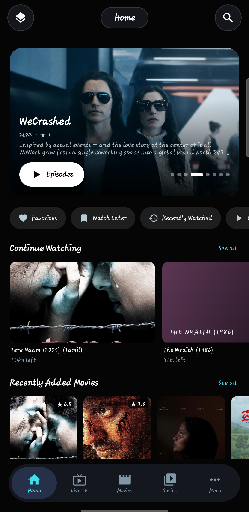</td>
    <td width="25%" valign="top">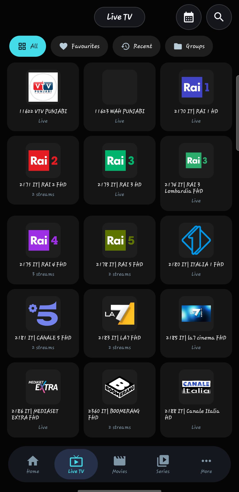</td>
    <td width="25%" valign="top">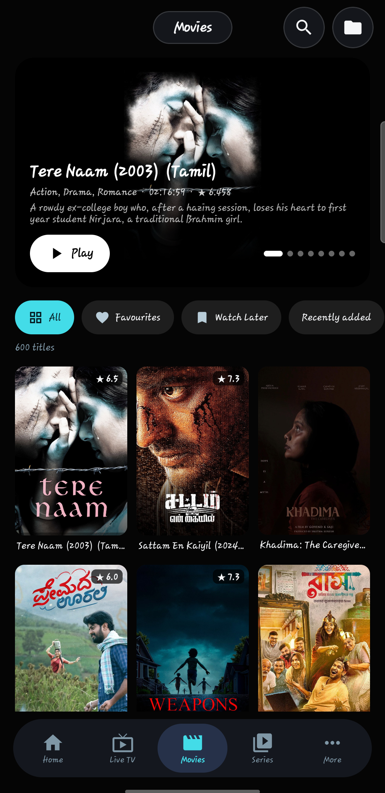</td>
    <td width="25%" valign="top">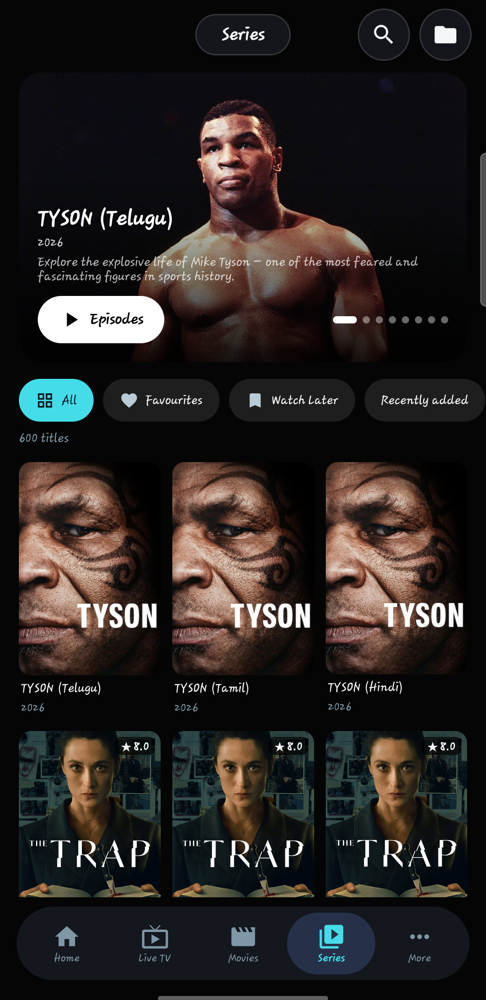</td>
  </tr>
  <tr>
    <td align="center">Home</td>
    <td align="center">Live TV</td>
    <td align="center">Movies</td>
    <td align="center">Series</td>
  </tr>
</table>

## iPhone

<table>
  <tr>
    <td width="25%" valign="top">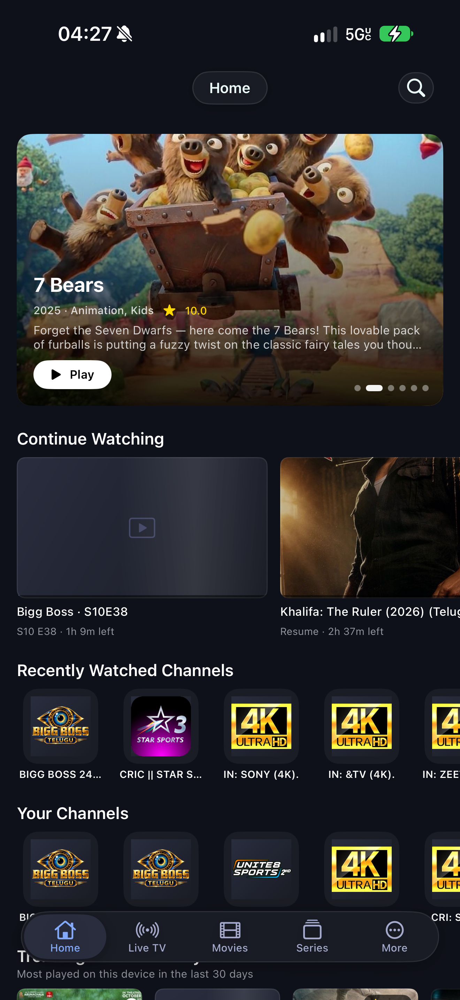</td>
    <td width="25%" valign="top">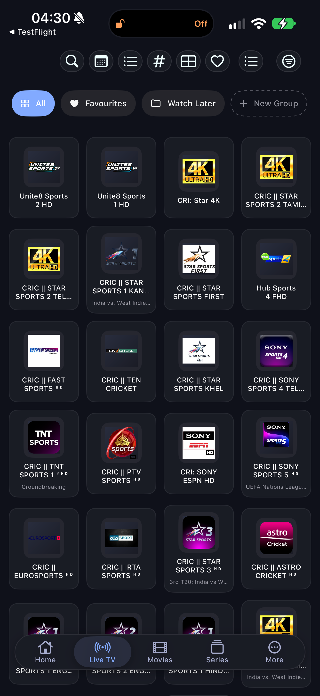</td>
    <td width="25%" valign="top">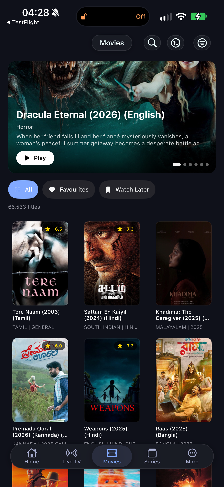</td>
    <td width="25%" valign="top">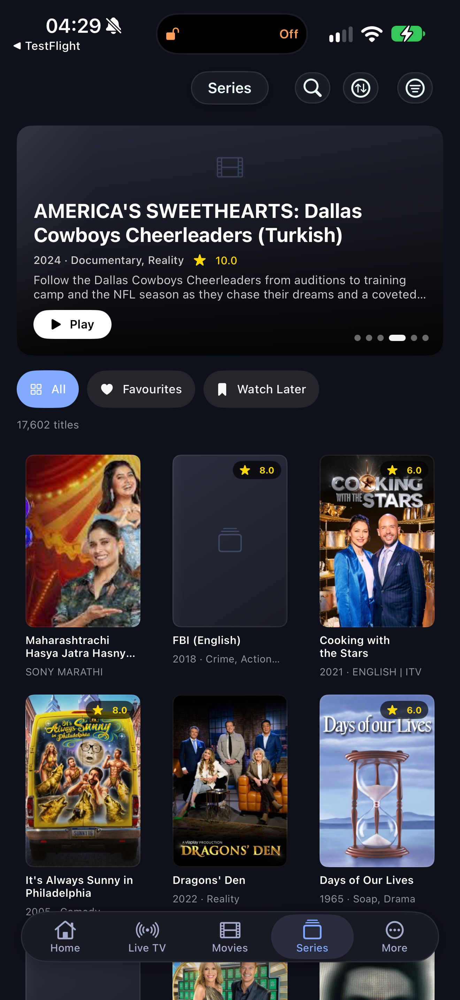</td>
  </tr>
  <tr>
    <td align="center">Home</td>
    <td align="center">Live TV</td>
    <td align="center">Movies</td>
    <td align="center">Series</td>
  </tr>
</table>

The artwork in these screenshots comes from the provider's own playlist. StreamSetu ships no content.
