

# 🖼️ StreamSetu screenshots

**Every app, screen by screen, in the order you meet them.**

[🖥️ Mac](#mac) &nbsp;·&nbsp; [📺 Fire TV and Android TV](#fire-tv-and-android-tv) &nbsp;·&nbsp; [📱 iPhone](#iphone) &nbsp;·&nbsp; [📱 iPad](#ipad) &nbsp;·&nbsp; [🤖 Android phone](#android-phone)

[← Back to the README](../README.md)

## Mac

From the opening screen, through every way to connect, to Home, Live TV, Movies, Series and the TV Guide.

### All screens, in order

<table>
  <tr>
    <td width="50%" valign="top" align="center"> <b>1</b> &nbsp;The opening screen: choose how to connect</td>
    <td width="50%" valign="top" align="center"> <b>2</b> &nbsp;Playlist link</td>
  </tr>
  <tr>
    <td width="50%" valign="top" align="center">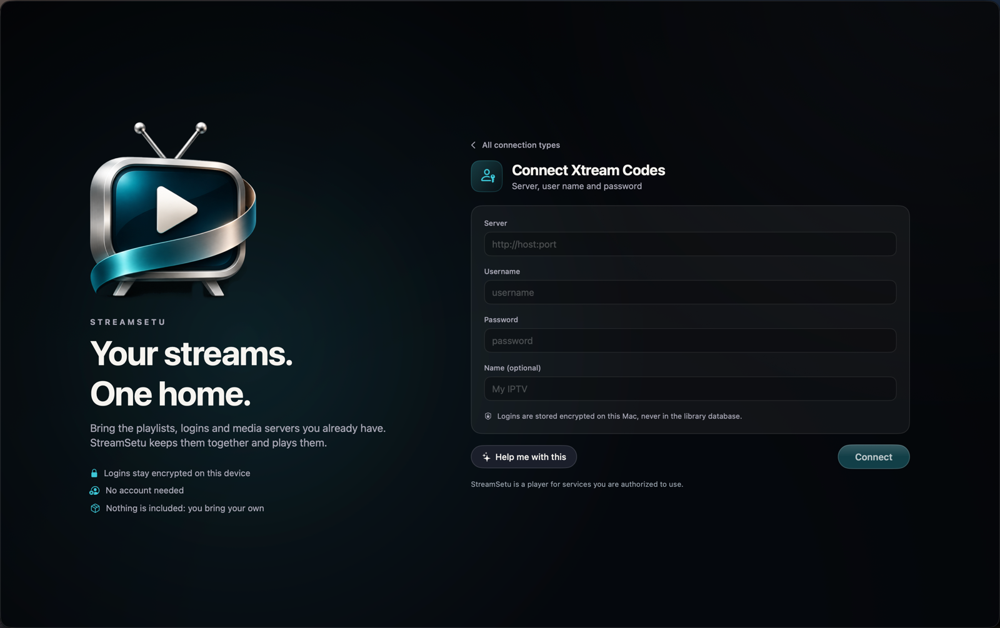 <b>3</b> &nbsp;Xtream Codes</td>
    <td width="50%" valign="top" align="center">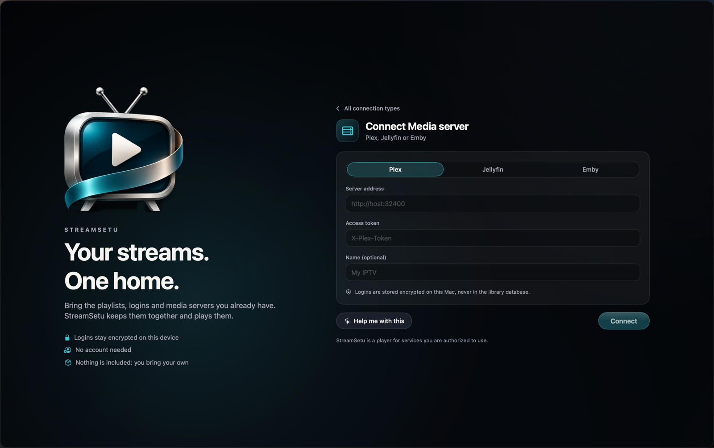 <b>4</b> &nbsp;Media server</td>
  </tr>
  <tr>
    <td width="50%" valign="top" align="center">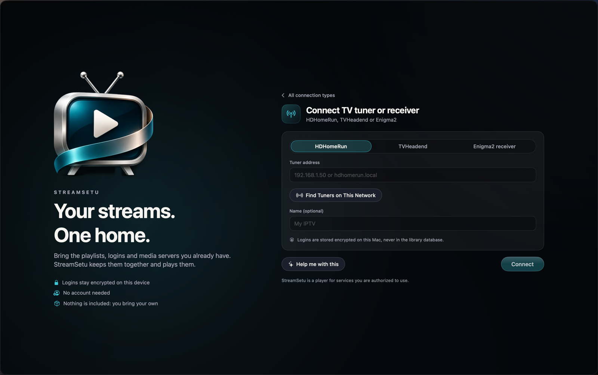 <b>5</b> &nbsp;TV tuner or receiver</td>
    <td width="50%" valign="top" align="center"> <b>6</b> &nbsp;Playlist file</td>
  </tr>
  <tr>
    <td width="50%" valign="top" align="center"> <b>7</b> &nbsp;Stalker portal</td>
    <td width="50%" valign="top" align="center">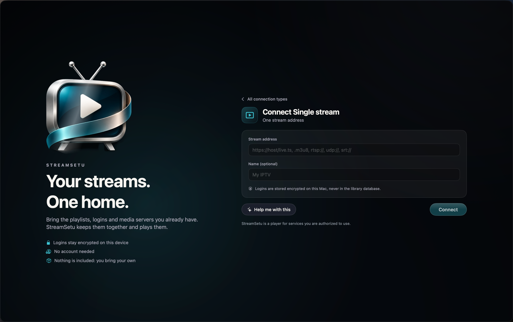 <b>8</b> &nbsp;Single stream</td>
  </tr>
  <tr>
    <td width="50%" valign="top" align="center"> <b>9</b> &nbsp;Home</td>
    <td width="50%" valign="top" align="center">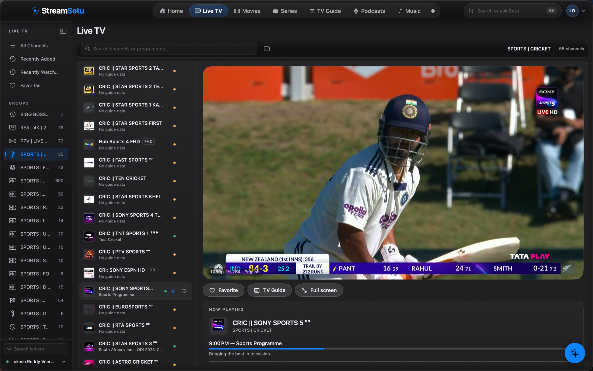 <b>10</b> &nbsp;Live TV</td>
  </tr>
  <tr>
    <td width="50%" valign="top" align="center">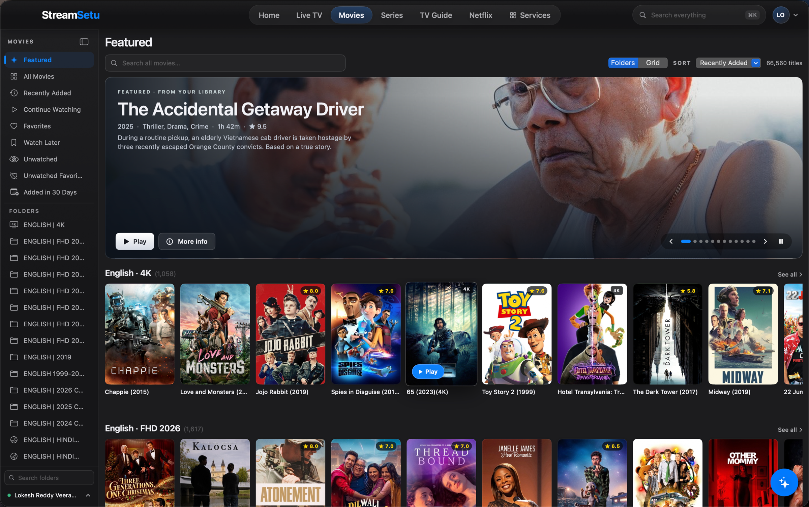 <b>11</b> &nbsp;Movies</td>
    <td width="50%" valign="top" align="center"> <b>12</b> &nbsp;Series</td>
  </tr>
  <tr>
    <td width="50%" valign="top" align="center">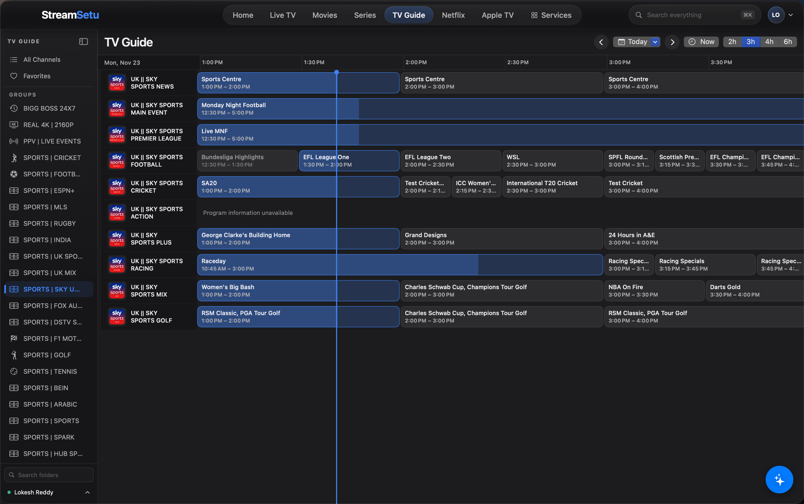 <b>13</b> &nbsp;TV Guide</td>
    <td width="50%"></td>
  </tr>
</table>

<a href="#streamsetu-screenshots">↑ Back to the top</a>

---

## Fire TV and Android TV

Built for the remote: a sidebar, big posters and a live preview.

### All screens, in order

<table>
  <tr>
    <td width="50%" valign="top" align="center"> <b>1</b> &nbsp;Home, with the sidebar open</td>
    <td width="50%" valign="top" align="center">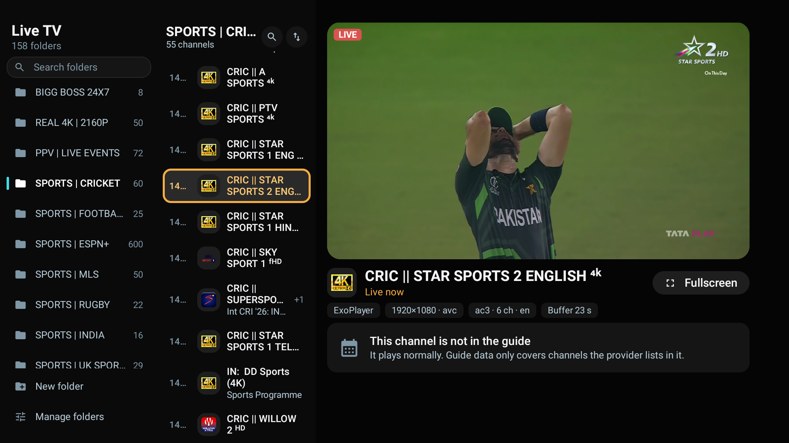 <b>2</b> &nbsp;Live TV: folders, channels and a live preview</td>
  </tr>
  <tr>
    <td width="50%" valign="top" align="center"> <b>3</b> &nbsp;Movies</td>
    <td width="50%" valign="top" align="center"> <b>4</b> &nbsp;Series</td>
  </tr>
</table>

<a href="#streamsetu-screenshots">↑ Back to the top</a>

---

## iPhone

From the launch screen to Settings, then the menus and the person page.

### All screens, in order

<table>
  <tr>
    <td width="25%" valign="top" align="center"> <b>1</b> &nbsp;Launch screen</td>
    <td width="25%" valign="top" align="center"> <b>2</b> &nbsp;Opening screen: choose how to connect</td>
    <td width="25%" valign="top" align="center"> <b>3</b> &nbsp;Home</td>
    <td width="25%" valign="top" align="center"> <b>4</b> &nbsp;Live TV</td>
  </tr>
  <tr>
    <td width="25%" valign="top" align="center"> <b>5</b> &nbsp;Movies</td>
    <td width="25%" valign="top" align="center"> <b>6</b> &nbsp;Title page</td>
    <td width="25%" valign="top" align="center"> <b>7</b> &nbsp;Title page: details, cast and more like this</td>
    <td width="25%" valign="top" align="center">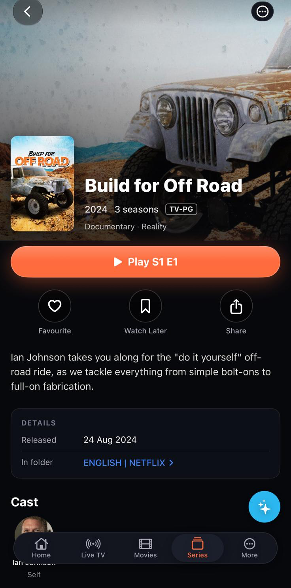 <b>8</b> &nbsp;Series title page</td>
  </tr>
  <tr>
    <td width="25%" valign="top" align="center">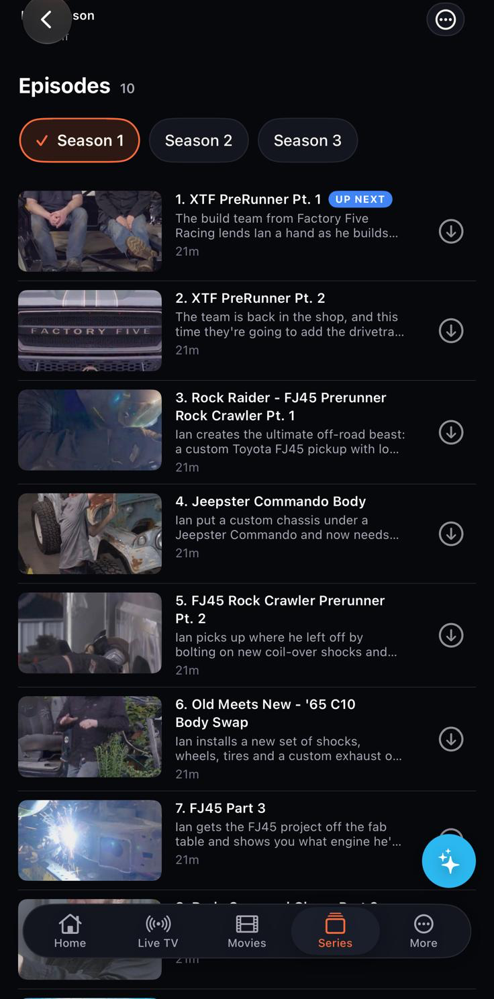 <b>9</b> &nbsp;Episodes</td>
    <td width="25%" valign="top" align="center"> <b>10</b> &nbsp;Settings</td>
    <td width="25%" valign="top" align="center"> <b>11</b> &nbsp;Channel menu</td>
    <td width="25%" valign="top" align="center"> <b>12</b> &nbsp;Title menu on Home</td>
  </tr>
  <tr>
    <td width="25%" valign="top" align="center"> <b>13</b> &nbsp;Person page</td>
    <td width="25%" valign="top" align="center">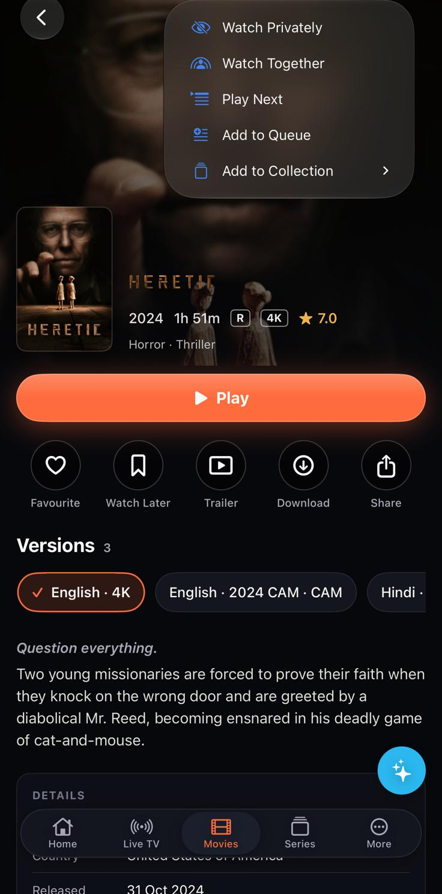 <b>14</b> &nbsp;Title page menu</td>
    <td width="25%" valign="top" align="center"> <b>15</b> &nbsp;Title menu in Movies</td>
    <td width="25%"></td>
  </tr>
</table>

<a href="#streamsetu-screenshots">↑ Back to the top</a>

---

## iPad

The sidebar and the full Home screen.

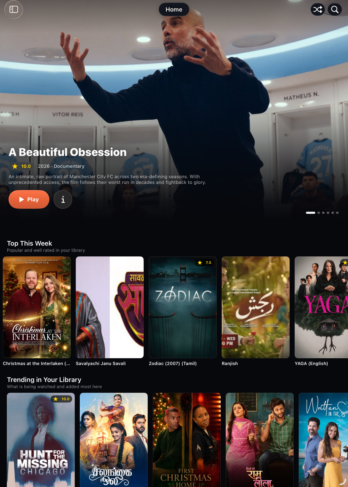

<a href="#streamsetu-screenshots">↑ Back to the top</a>

---

## Android phone

Touch layout for phones and tablets.

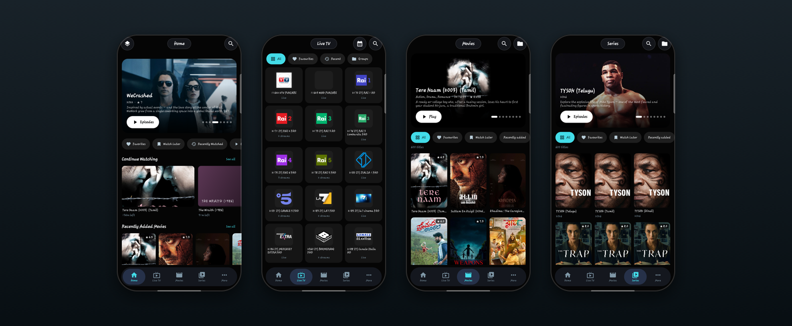

### All screens, in order

<table>
  <tr>
    <td width="25%" valign="top" align="center">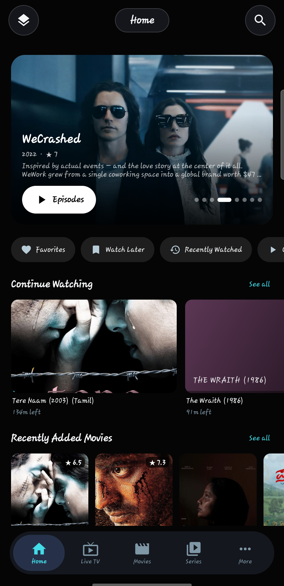 <b>1</b> &nbsp;Home</td>
    <td width="25%" valign="top" align="center"> <b>2</b> &nbsp;Live TV: channel grid</td>
    <td width="25%" valign="top" align="center"> <b>3</b> &nbsp;Movies</td>
    <td width="25%" valign="top" align="center"> <b>4</b> &nbsp;Series</td>
  </tr>
</table>

<a href="#streamsetu-screenshots">↑ Back to the top</a>

The artwork in these screenshots comes from the provider's own playlist. StreamSetu ships no content.
